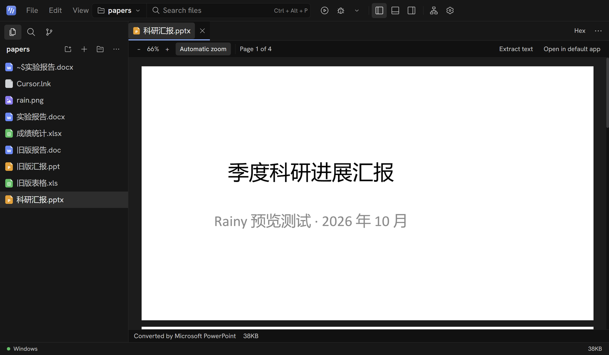

# Changelog

Highlights of each release. Installers, resource pieces and full notes are on [GitHub Releases](https://github.com/RainyMarks/Rainy/releases); [Validation](docs/validation.md) records the checks completed for each release.

English | [中文](CHANGELOG.zh.md)

## 4.5 · 2026-10-29

The agent works with each model the way the model's own vendor tunes it, so GPT, Claude, Gemini and Chinese models get close to their results at home.

- **Per-model adaptation**: Rainy recognizes the model family and gives it the guidance, edit tool and plan tool of the agent its vendor tunes it with. Claude follows Anthropic's prompting guidance for each model (Fable 5.1 also gets the nudge Anthropic recommends to batch independent tool calls); GPT-5 and later work like in Codex; Gemini follows Gemini CLI's rules; DeepSeek, Kimi, GLM, Qwen and MiniMax, which their vendors tune for Claude Code, get Claude Code's tools. Nothing to configure; switching models mid-chat switches too. [Details and sources](docs/model-adaptation.md).
- **`apply_patch` for GPT**: GPT models change files with Codex's patch format, several files in one call, on OpenAI's own API as the grammar-checked freeform tool Codex uses. A patch that does not fit changes nothing; files keep their encoding (GBK included) and line ends; the card shows a diff per file, and each file, a deleted or moved one too, can be undone.
- **The model's plan as a checklist**: models keep their task list with their own agent's tool (`todo_write`, `update_plan` or `write_todos`), and the chat shows it as a checklist with the progress in its title.
- **Automatic updates, on by default**: Rainy still checks for a new version shortly after it starts and every six hours, downloads it in the background and offers to restart; when you choose Later or just keep working, the update now installs silently as you close Rainy, so the next start is the new version. Settings → General → Automatic updates turns this off.
- **Strata uses what you already have**: a Strata you installed yourself is found and used as it is, with its engine and models (Rainy neither updates nor removes it). Under **Models you have**, choose a model file or folder (from an earlier Rainy, Strata's own app or GGUF files downloaded by hand): Strata recognizes the model and uses the files where they are instead of downloading them again. The files an earlier Rainy left get **Use these models**, and their note no longer calls them unused.
- A tool called with the wrong letter case still runs, and an unknown tool is answered with the list of tools. The changes bar no longer misses edits to GBK files. Closing the window no longer crashes Rainy on the way out, which left the Host and Strata to be stopped by Windows. Compaction summaries keep the approaches tried and the exact details.

## 4.4 · 2026-10-29

A new Agent mode puts the conversation in the middle of the window, and reasoning effort follows each model's official levels.

- **Agent mode**: Rainy opens on a conversation-first layout with the chat in the middle, the chats on the left grouped by project with pins and folding, and the files, terminals and the chat's changes on the right when you want them. The buttons at the left of the title bar or **Ctrl+Shift+A** switch back to IDE mode at any time, keeping the chat, its draft, running work, open files and terminals; the choice is remembered on this PC. **Ctrl+N** starts a new chat and **Ctrl+B** shows or hides the sidebar.
- **Official reasoning levels**: each model shows only the levels its provider documents, and GPT, Claude, DeepSeek, Qwen, GLM, Kimi, Gemini, Grok and others get their own request parameters, starting at the provider's default. Models that always reason or cannot reason say so. Older versions still read the settings and chats this one saves.
- **A model and reasoning card**: the button under the composer shows the model and its effort and opens a GPT-style card with the level in large type, a slider (drag it or click a level's name) and a reset to the provider's default; the model's name switches models.
- A chat created for a message is no longer selected after you moved to another one meanwhile; restoring the last archived chat leaves the archived view.

## 4.3 · 2026-10-29

Third-party tools become downloads: Strata local models follow Strata's newest release with a recommendation for this PC, and Tab completion is fixed.

- **A new Settings → Tools page**: Rainy ships no third-party tools; download what you need and uninstall it any time. The editor's Python tools (Ruff, ty, debugpy, about 26 MB) and JavaScript / TypeScript tools (TypeScript 7, js-debug, about 11 MB) are downloaded here too; without them the status bar says which download a language needs and opens the page. The installer is smaller for it.
- **Strata follows its newest release**: Rainy downloads Strata's latest version (checked against its install manifest, GitHub's digest and Strata's signed feed) and the engine for this PC's graphics card, then updates it when no model runs. The Strata 0.1.39 runtime Rainy used to provide is gone; the old component can be deleted in one click.
- **A model table with one-click downloads**: every model and size Strata supports, each with its download size, the memory it needs and whether it fits, fits slowly or does not fit, plus the size Strata recommends for this PC. Downloads show progress, can be cancelled and resumed, come from Hugging Face or ModelScope, and go to the roomiest non-system drive by default. Then Start, and Connect and set as default to chat.
- **The "tmp" error is fixed**: every Strata process gets Rainy's own folders and a writable temporary folder with an ASCII path, so it starts under a Chinese user name or an unusable TEMP, and it all ends with Rainy.
- **Tab completion**: AI suggestions no longer repeat the indentation, word or closing bracket already around the cursor; Tab with the completion list open takes the highlighted item (it used to insert spaces); an auto-import completion adds its `import` line and no longer repeats the letters typed; Enter after a wrapped long line keeps its indentation. In the chat box Tab only completes a `/command` and Enter runs it, and typing `@file` quickly no longer picks an outdated result.
- **Steadier**: Ctrl+K V and the changed-on-disk banner work in Markdown pages; Ctrl+F finds text in PDFs; the hex view can read a file as text in GB18030, UTF-8 and other encodings; closing the window and updating no longer freeze the interface; SSH hosts whose config sets a `RemoteCommand` (such as attaching tmux) work; a WSL Host that ignores stop is ended completely; more errors follow the interface language.

## 4.2 · 2026-10-25

A full checkup: Markdown no longer damages files, the image, PDF and hex views are back, and many details are smoother.

- **4.2.2: a reasoning slider, an image input switch per model, and pasted screenshots that work.** A strength meter beside the model name opens a slider with off, low, high and max; the level applies when you let go, and the model menu lists only models. Thinking blocks show Rainy's mark, which breathes while the model thinks. **Settings → Models** turns image input on or off for each model, and the DeepSeek preset takes images (models you saved keep their setting). A screenshot pasted on Windows showed a blank thumbnail and reached the model with the wrong type; images are now typed by their content and screenshots sent as PNG. Unused interface strings and 13 MB of retired tool catalog files are gone.
- **4.2.1: Markdown saves what you wrote.** On lines edited in the rich view `$5` is no longer saved as `\$5`, and reference links such as `[text][1]` keep their form and definitions instead of becoming inline links. Typora's `[TOC]` (updated as headings change, clickable, also in previews and exports) and `==highlight==` (toolbar button or Ctrl+Shift+H) work. Ctrl+Shift+V toggles the preview also while the rich view or the preview has the keyboard.
- **Markdown no longer damages files**: the first rich edit of a file with Windows line ends (CRLF) appended a second copy of the document, and editing a list item next to blank lines could drop or repeat other items. Saving now changes only the lines you edited and keeps the line ends. When the AI changes an open file the page shows the new text at once, your next edit no longer overwrites it, and Ctrl+Z undoes only your own typing.
- **Markdown closer to Typora**: code blocks in the light mode follow the color scheme instead of a dark theme's gray text; table borders, selected cells and the / menu's current item are visible. Enter in a table goes to the next row, Ctrl+Enter adds one. A ` ```latex ` block stays code and amounts such as `$5 to $10` are no formula. The / menu inserts images (Ctrl+Shift+I). Previews and exports leave out HTML comments (`<!-- notes -->` used to be printed into PDFs), show ``, `<br>` and sub/superscripts, link footnotes and draw Mermaid diagrams. The split view scrolls both sides together; Ctrl+Shift+V toggles the preview, Ctrl+K V the split. The status bar shows the word count, and no meaningless "line 1, column 1" in the rich view or preview.
- **Images, SVG and hex are back**: images zoom, pan, show pixel colors and a checkerboard behind transparency, and can be added to the chat; AVIF, APNG, CUR and more open. SVG shows the picture with source and split views. Binary files open in a hex view with go-to and copy.
- **PDF**: text can be selected and copied and links clicked; zooming or resizing keeps your place; Ctrl+wheel and Ctrl+= / Ctrl+- zoom; protected PDFs ask for the password; Extract text keeps line breaks and adds no spaces between Chinese characters. In the light mode pages sit on a gray backdrop and spreadsheet grids and headers are visible. Narrow toolbars fold into a More menu. Office conversion failures are explained in your language.
- **Chat**: a failed send puts your text and images back; each chat keeps its own draft; long chats load older messages; chat history can be searched, is grouped by project, and archived chats can be reached again. Tool cards show diffs with +/− counts and exit codes, open the file and undo a single change. Enter allows and Esc denies once the approval bar has focus. A new chat can pick its permission mode first.
- **Interface**: notifications are no longer hidden behind PDF, Markdown and other pages; the title bar turns into icons when narrow and always keeps the window buttons; pane sizes are kept per project; the status bar shows the Git branch and change count; warning text and selected buttons are readable in the light mode; Chinese 。 and ， never start a line. Errors on WSL and SSH are in your language, with the original message below.
- **Sturdier**: `grep` no longer fills memory on huge files and searches UTF-16 files; Stop works at once on a stuck HTTP MCP tool; an MCP server writing GBK Chinese on stderr stays connected; the reply limit is no longer tiny right after compaction; a damaged `settings.json` or `desktop.json` keeps what is valid and saves the original aside. The Strata engine exits with Rainy; interrupted component downloads start over; an update without a signature is refused; a window left open checks for updates every six hours. Empty `node` folders left after updating from 4.0 are removed.

## 4.1 · 2026-10-23

No Node.js anywhere, and Strata local inference is back.

- **4.1.1: Markdown editing you can see.** In the rich editor the selection toolbar, the / menu, the + and drag handles beside each block, list numbers, checkboxes and table buttons were all but invisible in the dark mode; in the light mode code blocks, table headers and front matter merged with the page. All of them now stand out in every color scheme, and floating panels have a border and shadow. The block handle no longer sits outside the window, the / menu fits a short pane, tooltips of the toolbar, links and tables are in Chinese, code blocks use Rainy's code font, and diagrams take the page's colors. The preview and split views show front matter in its own box instead of a rule and a large heading. The tab of the open file is scrolled into view after a restart.
- **The backend is a Rust program**: what runs your chats, the agent's tools, files, terminals, runs and debugging is now `rainy-host`, a native program, on Windows, in WSL and on SSH servers. Rainy no longer contains Node.js: the installer shrinks from 67 MB to 52 MB, about 165 MB installed (4.0: about 280 MB). Chats, settings, keys, projects and project memory keep their formats, so 4.1 opens what 3.x and 4.0 wrote and the other way round. The Linux runtime that WSL and SSH servers download shrinks from 53 MB to 27 MB (about 110 MB installed on a server, 250 MB before).
- **Native language services**: ty for Python and TypeScript 7's native compiler for JavaScript and TypeScript (completion, errors, go to definition, references, rename and formatting); Ruff still formats Python. Running and debugging your own JavaScript and TypeScript uses the Node.js installed where the project runs.
- **Strata local inference is back** in **Settings → Models → Strata local model**: download the engine (about 533 MB), choose your Qwen3.8 Flash Next GGUF (or a model folder or Strata profile) and its MTP weights, start it, and connect it as the default model. A Strata server started elsewhere is recognized and never stopped by Rainy. A WSL or SSH project connects only when it can reach the server; Rainy never falls back to a cloud model.
- **MCP tools one by one**: under each server in **Settings → Skills & MCP**, "Tools: x / y enabled" lists the server's tools with a switch each, Enable all and Disable all; hovering a tool shows its description. A switch takes effect at the next message without reconnecting the server.
- The send button stays in view in a narrow chat panel with a long model name.

## 4.0 · 2026-10-22

The interface is now a native program: no Chromium inside, faster to open and lighter to run.

- **Native interface**: the window, chats, editor, terminal and settings are drawn on the GPU with Rust and GPUI; the installer no longer carries Electron and its Chromium and shrinks from 180 MB to 67 MB, about 280 MB installed (3.9: about 570 MB). The backend is unchanged: the Windows, WSL and SSH execution environments, and your chats, settings, keys and projects carry over, so an upgrade from 3.9 needs no setup.
- **Document previews use the WebView2 that comes with Windows**: PDF, Word, Excel, PowerPoint, rich Markdown, the project map and the AI's built-in browser work as before. Windows 11 includes WebView2; on Windows 10 without it, opening such a file says how to install it.
- **Language services in the editor**: Python, JavaScript / TypeScript and C / C++ get completion, hover, error squiggles, go to definition (F12), find all references (Shift+F12), rename symbol (F2) and formatting (Shift+Alt+F), also on the right-click menu.
- **Editor AI**: grey inline suggestions (Tab accepts; turn them on in Settings); select code and press Ctrl+K to say how to change it, the new code goes straight into the editor, Ctrl+Enter keeps it and Esc restores the old; send the selection to the AI; "Fix with AI" on every problem in the list.
- **Run and debug**: the Run button and its menu in the title bar, run configurations (arguments, environment, interpreter, single-file or CMake builds for C/C++); Ctrl+F5 runs, F5 debugs, F9 sets breakpoints, F10 / F11 / Shift+F11 step, Shift+F5 stops. The bottom panel has Terminal, Problems and Debug pages; Debug shows the call stack, threads, breakpoints, variables, watches and a debug console, and the editor marks breakpoints and where execution stopped.
- **The command palette** (F1 or Ctrl+Shift+P) has every 3.x command; the project map, the Markdown outline, PDF / HTML export, focus and typewriter modes and adding folders to a project are all there.
- **Strata local inference is not offered yet**: its engine manager has not moved to the new interface; keep 3.9 if you need it.

## 3.9 · 2026-10-21

Write Markdown the way you do in Typora, and open files straight from Explorer.

- **3.9.2: import MCP servers from JSON.** In **Settings → Skills & MCP**, Import JSON takes the MCP configuration of Claude Desktop, Claude Code, Cursor, VS Code, Windsurf, Cline, Roo, Zed, Gemini CLI, opencode, Continue, Cherry Studio, or a snippet copied from a server's page, pasted or chosen as a file; comments, trailing commas, Markdown fences and single-backslash Windows paths are read. Each server is shown first with its secrets hidden, and only the ones you check are added; servers you already have are left out. MCP JSON pasted into an empty new-server form opens the import. Servers that only speak the older HTTP+SSE transport now connect.
- **3.9.2: folders on mounted disk images open.** A folder on a disk mounted by a forensic tool such as 火眼, a RAM disk or another virtual drive was refused as "not a folder", because Windows could not name its volume; Rainy now resolves such paths itself.
- **3.9.2: the window stays where you drag it.** Dragging the window partly off the screen no longer makes it jump back; it is brought back only when its title bar is out of reach.
- **3.9.2: Explorer integration removes even less.** Turning a part off no longer touches a part Rainy never registered, keeps the RainyAgent.exe entry Windows writes when you pick Rainy under "Choose another app", and leaves the keys above Rainy's own when it does not know whether they were there before. A switch that fails to turn on is saved as off again.
- **3.9.1: Explorer integration is opt-in.** 3.9.0 registered "Open with Rainy" and Rainy's file types by itself, and file types without a default app then opened in Rainy. Both parts are now off until you turn them on in **Settings → General → System integration**; the update removes what 3.9.0 wrote. Turning a part off removes only Rainy's own registry entries, never other apps' or keys you had.
- **Explorer integration** (off until you turn it on, since 3.9.1): right-click a file, a folder or the background of a folder for "Open with Rainy" (on Windows 11 under "Show more options"). Rainy is listed under "Open with" for Markdown, text and common source code files and can be made their default app in Windows' Default apps settings; while Rainy is running, files opened this way go to the same window. A file opens in the project that holds it, or with its folder as the project. Both parts are switched in **Settings → General → System integration** and are removed when Rainy is uninstalled.
- **Outline**: a new side pane lists the document's headings, marks the one you are reading and jumps to any of them.
- **Find and replace**: Ctrl+F / Ctrl+H in the rich view, with match case and replace all; a replacement is undone in one step.
- **Pasted images**: paste a screenshot or drop an image into a document and it is saved to an `assets` folder next to it (or a "name.assets" folder, or the document's own folder, set in Settings) with a relative link. Pasted images used to become broken temporary links.
- **Math and diagrams**: math blocks and Mermaid diagrams show only their rendering until you click them, then their source with a live preview, as in Typora.
- **Front matter** gets its own editable box at the top instead of being rendered as a rule and a heading.
- **Typora's shortcuts**: Ctrl+0–6 for paragraph and headings, Ctrl+= / Ctrl+- to change the heading level, Ctrl+T table, Ctrl+Shift+K code block, Ctrl+Shift+M math block, Ctrl+Shift+Q quote, Ctrl+K link, Ctrl+/ source view; Ctrl+click opens a link (a web address, a project file or a `#heading` in the document).
- **Focus mode (F8) and typewriter mode (F9)**; the status bar shows the word count, with characters and reading time on hover.
- **Export to PDF or HTML** from the File menu or the "…" menu of the editor, with images, math and diagrams embedded, ready to send. PDFs get bookmarks from the headings, and their Chinese text copies and searches as written: characters such as 二 and 文 no longer come out as the look-alike Kangxi radicals that PDFs printed by many Chromium-based apps contain.
- Typography follows Typora's GitHub theme: bold headings, underlined first and second levels, bordered tables and roomier lines.

## 3.8 · 2026-10-19

Lighter: smaller downloads, less CPU while idle and while a reply streams.

- **The WSL / SSH runtime base shrinks from about 277 MB to about 53 MB**: it is packed with xz and leaves out what the Host never reads (Node.js headers, a second copy of Ruff, the debugger's sources and other platforms' binaries). The offline Ubuntu 26.04 development packages (about 165 MB) are downloaded only when you prepare the development tools, and the download is deleted once they are installed. This update downloads the new base once.
- **Less work while idle**: the rain behind empty views draws at most about 60 frames a second (24 while the window is in the background) at a lower canvas resolution, about a third of the idle CPU it used on high-refresh displays; the running spinner turns on the GPU instead of being repainted every frame.
- **Smoother long replies**: while a reply streams, only the turn that grows renders again and only its last Markdown block is parsed again; the Host sends the page only the new text, with the whole reply every 2 seconds, so far less goes over an SSH tunnel.
- **Faster start**: Settings and code highlighting load on first use, cutting the startup script from 1010 KB to 790 KB; math ships WOFF2 fonts only.

## 3.7 · 2026-10-19

The agent keeps servers running, checks its own work and hands searches to sub-agents.

- **Background commands**: a development server or watcher keeps running in the background; the agent gets an ID, goes on working, reads the new output when it needs it and stops the command when done. The commands are listed above the message box with a stop button each and end when the chat closes.
- **It checks its own work**: after changing a web application the agent opens it in a preview window on this machine, reads the page, its console errors and its failed requests, clicks and types, and looks again. The preview opens local addresses only and carries no sign-ins.
- **Sub-agents**: a long search goes to a sub-agent that only reads and answers with one report, so the conversation keeps its room; sub-agents started in one step run at the same time.
- **Faster suggestions**: editor suggestions stream in as they are written, are requested 0.18 s after typing stops, and continue right after Tab accepts one.

## 3.6 · 2026-10-18

Updates no longer set up the environment again, and Rainy is lighter.

- **No Linux runtime download after an update**: every update used to download the Linux runtime (about 280 MB) again on the first WSL or SSH start. It now comes in two layers: a base that rarely changes (Node.js, dependencies, IDE tools) and an application layer of a few MB that ships with the installer. While the base is unchanged, an update swaps in the new application layer without downloading or reinstalling anything; the update from 3.5 to 3.6 reuses the environment you already have, too.
- **Interactive answers removed**: they suit plain conversation better than Rainy's agent work, so they are gone, with the chart and 3D libraries they shipped.

## 3.5 · 2026-10-17

- **Every screen and scaling**: at high display scaling (such as 225%) or on small screens the menus no longer run under the search box; the window fits the screen's work area when it opens, when it moves to another display and when the scaling changes; the chat pane follows the window width until you resize it.

## 3.4 · 2026-10-17

Notes and documents are easier to work on.

- **WYSIWYG Markdown**: a .md file opens formatted, and you type on it as in Typora; headings, lists, task lists, tables, code blocks and LaTeX math take shape as you write, and `/` inserts any of them. Source, Preview and Split are one click away. Saving changes only the lines you edited, so escapes, blank lines and table spelling elsewhere in the file stay as they were.
- **Chinese PDFs no longer come out blank**: PDFs that do not embed their Chinese fonts, as many papers and official documents do not, used to show only their English text; now the Chinese shows too.
- **Password-protected Office files** say that they need their password and offer Open in default app, instead of hanging on a password prompt nobody can see.

## 3.3 · 2026-10-17

The AI can go online: look up current documentation, papers, version numbers and error messages, then read the pages it needs in full.

- **Search the web** with DeepSeek's own search engine: titles, links, dates and summaries, with `site:`, `"exact phrase"`, `lang:zh` and `after:2025` syntax. Links in the result card open in your browser.
- **Read a web page** as Markdown. Reading a site for the first time asks you first, and you can remember the site; fully automatic chats do not ask.
- **DeepSeek only**: it uses the API key of the DeepSeek model you added, and your DeepSeek account pays (5 yuan per 1,000 searches or page reads; failed and empty requests are free). Without a DeepSeek key the two tools do not appear. Turn it off in **Settings → Models → Web search**.

## 3.2 · 2026-10-17

Rainy turns from CTF to office work, research and coding. Open a folder of papers, reports and spreadsheets and click a file to read it, instead of a screen of hex.



- **Word**: Rainy draws .docx files itself as paginated paper with headings, tables, pictures, headers and footers, no Office needed. For the exact Word layout, click **Office layout**.
- **PowerPoint and legacy Word**: .pptx, .ppt and .doc files are turned into PDF by the Microsoft Office (or WPS) installed on your PC, so charts, tables and fonts match the original and the text can be extracted. Without Office, Rainy lists the text of each slide.
- **Excel**: .xlsx, .xls and .ods files show as tables with fixed row and column headings, merged cells and a tab per sheet.
- **Open in default app**: one click hands a document to Word, PowerPoint, Excel or WPS for editing (documents only; programs are never started).
- **Small files explained**: a `~$` file says it is an Office lock file and who has which document open; a `.lnk` shortcut shows where it points.

## 3.1 · 2026-10-16

Rainy now looks like its name.


- **Rain on empty views**: the welcome view, an editor with no file open and a new chat show light, slanted rain in your accent color, with small rings where drops land. Click the background and a ripple spreads, pushing and lighting the rain it passes. It follows the color scheme and accent, pauses while the window is hidden, stays still when Windows asks for reduced motion, and can be turned off in **Settings → Appearance → Motion**.
- **A living mark**: the Rainy mark takes your accent color. Point at it and its three bars fall like rain; in the top bar they keep falling while the current chat works, and finish their fall when it stops.
- **Reasoning as a rain cloud**: the reasoning row shows a rain cloud instead of the atom icon inherited from DeepSeek Harness, and its drops fall while the model thinks.
- **New typefaces (3.1.1)**: Latin text uses the bundled Hanken Grotesk and code, the editor and the terminal use Geist Mono, so Rainy looks the same on every PC; Chinese stays in Microsoft YaHei. Your own choices in **Settings → Appearance → Fonts** still come first.
- A refreshed application icon with a light-to-deep blue tile, and the last DeepSeek Harness names removed from the interface code.

## Earlier releases

3.0 added SSH remote development and dropped the CTF toolkit; 2.5 added project-wide search and replace, the command palette and the Git panel; 2.4 the project map and review of the agent's changes; 2.3 inline AI completion and Ctrl+K edits. See the [release notes](https://github.com/RainyMarks/Rainy/releases) for every version.
