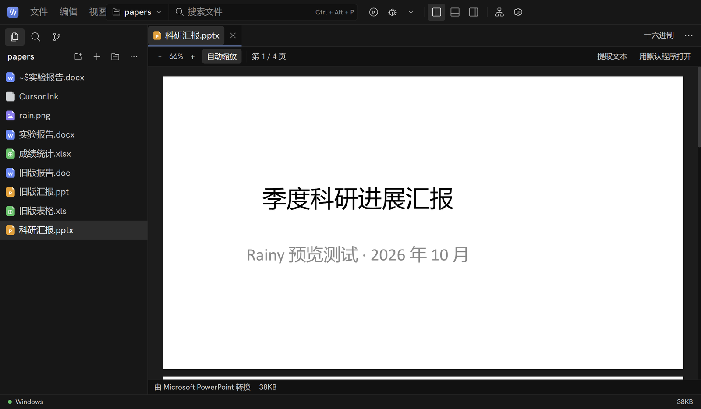

# 更新日志

每个版本的要点。安装包、资源分片和完整说明见 [GitHub Releases](https://github.com/RainyMarks/Rainy/releases)，每个版本的验收情况见[验收记录](docs/validation.md)。

[English](CHANGELOG.md) | 中文

## 4.0 · 2026-10-22

界面整个改成原生程序：不再带 Chromium，打开更快，占用更少。

- **原生界面**：窗口、对话、编辑器、终端和设置改用 Rust 和 GPUI 直接用显卡绘制，安装包里不再有 Electron 和它自带的 Chromium。后台没有变：Windows、WSL 和 SSH 三种执行环境，以及对话记录、设置、密钥和项目都原样沿用，从 3.9 升级不用重新配置。
- **文档预览用系统自带的 WebView2**：PDF、Word、Excel、PPT、所见即所得 Markdown、项目地图和 AI 的内置浏览器照旧。Windows 11 自带 WebView2；Windows 10 上没有时，打开这类文件会提示安装。
- **编辑器的语言服务**：Python、JavaScript / TypeScript 和 C / C++ 有补全、悬停说明、错误波浪线、转到定义（F12）、查找所有引用（Shift+F12）、重命名符号（F2）和格式化（Shift+Alt+F），右键菜单里也有。
- **编辑器 AI**：灰色的行内补全（按 Tab 采纳，在设置里打开）；选中代码按 Ctrl+K 说出要怎么改，新代码直接放进编辑器，Ctrl+Enter 接受、Esc 还原；选中的代码可以发给 AI 分析；问题列表里每条都能“用 AI 修复”。
- **运行和调试**：标题栏的运行按钮和运行方式菜单、运行配置（参数、环境变量、解释器、C/C++ 的单文件或 CMake 构建）；Ctrl+F5 运行，F5 调试，F9 断点，F10 / F11 / Shift+F11 单步，Shift+F5 停止。底部面板分终端、问题、调试三页，调试页有调用栈、线程、断点、变量、监视和调试控制台，编辑器里标出断点和暂停的位置。
- **命令面板**（F1 或 Ctrl+Shift+P）包含 3.x 的全部命令；项目地图、Markdown 大纲、导出 PDF / HTML、专注和打字机模式、往项目里添加文件夹都在。
- **暂不提供 Strata 本地推理**：它的引擎管理还没有移到新界面，需要时请继续用 3.9。

## 3.9 · 2026-10-21

像 Typora 一样写 Markdown，也能从资源管理器直接打开。

- **3.9.2：用 JSON 导入 MCP 服务器。** 在 **设置 → Skills 与 MCP** 里点“导入 JSON”，粘贴或选择 Claude Desktop、Claude Code、Cursor、VS Code、Windsurf、Cline、Roo、Zed、Gemini CLI、opencode、Continue、Cherry Studio 的 MCP 配置，或服务器页面上给的片段；注释、多余的逗号、Markdown 代码块和单反斜杠的 Windows 路径都能识别。每个服务器先预览（密钥隐藏），只添加你勾选的，已经有的会跳过。在空白的新服务器表单里粘贴 MCP JSON 也会打开导入。只支持旧版 HTTP+SSE 的服务器现在也能连上。
- **3.9.2：挂载的磁盘镜像里的文件夹能打开了。** 用火眼等取证工具挂载的磁盘、内存盘和其他虚拟盘上的文件夹，以前会提示“所选路径不是文件夹”，原因是 Windows 说不出这类卷的盘符；现在 Rainy 自己解析这类路径。
- **3.9.2：窗口拖到哪里就停在哪里。** 把窗口拖到一部分出了屏幕，不会再被拉回来；只有标题栏够不着时才移回屏幕内。
- **3.9.2：资源管理器集成删得更少。** 关闭某一项时不再碰 Rainy 没登记过的部分；你在“选择其他应用”里选过 Rainy 时 Windows 写的 RainyAgent.exe 条目会保留；不确定原来是否存在的上层键一律保留。打开失败的开关会重新存为关闭。
- **3.9.1：资源管理器集成改为自己选择开启。** 3.9.0 会自动登记“通过 Rainy 打开”和 Rainy 的文件类型，没有默认应用的文件类型因此会直接用 Rainy 打开。现在两项默认关闭，需要时在 **设置 → 通用设置 → 系统集成** 里打开；更新后会删除 3.9.0 写入的登记。关闭时只删 Rainy 自己的注册表项，不动其他程序的登记和你原有的键。
- **资源管理器集成**：右键文件、文件夹或文件夹空白处，都有“通过 Rainy 打开”（Windows 11 中在“显示更多选项”里）。Markdown、文本和常见源代码文件的“打开方式”里会列出 Rainy，可以在 Windows 的默认应用设置里把它设为默认；Rainy 已经开着时，新打开的文件交给同一个窗口。文件跟它所在的项目一起打开，不在任何项目里时以它所在的文件夹作为项目。自 3.9.1 起默认关闭，在 **设置 → 通用设置 → 系统集成** 里开关，卸载时自动清除。
- **大纲**：侧栏新增大纲，跟着阅读位置高亮当前标题，点击即跳转。
- **查找替换**：所见即所得视图里按 Ctrl+F / Ctrl+H 查找替换，可区分大小写、全部替换，替换后一步就能撤销。
- **粘贴图片**：截图直接粘贴、图片拖进文档，自动保存到文档旁的 `assets` 文件夹（可在设置里改成“文档名.assets”或文档所在文件夹）并写入相对路径。以前粘贴的图片只会写入无效的临时链接。
- **公式与图表**：公式块和 Mermaid 图表平时只显示渲染结果，点一下才显示源码并实时预览，和 Typora 一样。
- **YAML 前言**单独显示在文档顶部，可以直接修改，不再被排成分隔线和标题。
- **Typora 快捷键**：Ctrl+0–6 设置正文和标题，Ctrl+= / Ctrl+- 调整标题级别，Ctrl+T 表格，Ctrl+Shift+K 代码块，Ctrl+Shift+M 公式块，Ctrl+Shift+Q 引用，Ctrl+K 链接，Ctrl+/ 切换源码；按住 Ctrl 单击打开链接（网址、项目里的文件或本文的 `#标题`）。
- **专注模式（F8）和打字机模式（F9）**；状态栏显示字数，悬停可看字符数和阅读时间。
- **导出 PDF / HTML**：在“文件”菜单或编辑器右上角的“…”里导出，图片、公式和图表都嵌进文件，发给别人直接能看。PDF 按标题生成书签；里面的中文复制、搜索都正常，不会像很多基于 Chromium 的软件导出的 PDF 那样把“二”“文”等字复制成长得一样的康熙部首。
- 排版向 Typora 的 GitHub 主题看齐：标题加粗，一、二级标题带下划线，表格有边框，行距更舒展。

## 3.8 · 2026-10-19

更轻：下载更小，空闲和对话时更省电。

- **WSL / SSH 运行环境底座从约 277 MB 缩到约 53 MB**：改用 xz 压缩，并去掉用不到的文件（Node.js 头文件、重复的 Ruff、调试器的源码和其他平台的二进制）。Ubuntu 26.04 的离线开发工具包（约 165 MB）改成在“准备开发工具”时才下载，装好后自动删掉下载的文件。这次更新会下载一次新的底座。
- **空闲更省电**：空白页的雨滴动画每秒最多画约 60 帧（窗口在后台时 24 帧），画布分辨率也降了，在高刷新率屏幕上空闲 CPU 占用降到原来的三分之一左右；运行中的转圈图标交给显卡转，不再每帧重绘。
- **长回复更流畅**：AI 输出时只重新渲染正在增长的那一轮对话，Markdown 只重新解析最后一段；Host 只把新增的文字发给界面，每 2 秒再发一次完整内容兜底，SSH 远程时流量少得多。
- **启动更快**：设置页、代码高亮按需加载，首屏脚本从 1010 KB 降到 790 KB；数学公式只保留 WOFF2 字体。

## 3.7 · 2026-10-19

AI 可以开着服务器干活、自己验收成果，还能派出子 Agent。

- **后台命令**：开发服务器、监听编译这类不会自己结束的命令可以放到后台，AI 拿到编号后继续做别的事，需要时再读新输出，用完就停掉。输入框上方列出这些命令，每个都能停止；关掉对话时全部停掉。
- **自己检查成果**：改完网页应用，AI 在本机预览窗口里打开它，读取页面文字、控制台报错和加载失败的请求，点击、输入后再看一眼。预览只能打开本机地址，不带任何登录信息。
- **子 Agent**：费时的查找交给子 Agent，它只读不改，最后只回一份报告，对话的上下文不会被中间过程塞满；同一步里派出的多个子 Agent 同时进行。
- **补全更快**：编辑器补全边生成边显示，打字停顿后 0.18 秒就请求，按 Tab 采纳后立刻接着给下一段。

## 3.6 · 2026-10-18

更新不再需要重新配环境，软件也更轻了。

- **更新后不用重新下载 WSL 运行环境**：以前每次更新，第一次以 WSL 或 SSH 启动都要重新下载约 280 MB 的 Linux 运行环境。现在它分成两层：很少变化的底座（Node.js、依赖和开发工具）和随安装包附带、只有几 MB 的应用层。只要底座没变，更新后直接换上新的应用层，不下载、不重装。从 3.5 升级到 3.6 这一次也会复用你已经装好的环境。
- **移除交互式回答**：3.5 加入的交互式回答更适合纯聊天，和 Rainy 以干活为主的智能体不太搭，已经移除，附带的图表和三维库也一起去掉了。

## 3.5 · 2026-10-17

- **适配各种屏幕和缩放**：在高缩放（比如 225%）或小屏幕上，顶部菜单不再和搜索框叠在一起；窗口打开时、换显示器时或改了系统缩放后，会自动缩放到屏幕可用范围内，小屏幕也不会出界；对话面板宽度跟着窗口大小走，大屏幕上更宽，拖动过之后就按你拖的宽度。

## 3.4 · 2026-10-17

写笔记、改文档更顺手了。

- **Markdown 所见即所得**：打开 .md 文件就是排好版的样子，像 Typora 一样直接在上面打字修改；标题、列表、任务清单、表格、代码块和 LaTeX 公式即时变样，输入 `/` 可以插入各种内容。顶部可以随时切到“源码”“预览”“分栏”。保存时只改你动过的那几行，其余内容（转义字符、空行、表格写法）原样保留，不会因为编辑一句话就改动整个文件。
- **中文 PDF 不再空白**：没有嵌入字体的中文 PDF（很多论文和公文都是这样）以前只显示英文，中文是空白，现在能正常显示。
- **加密的 Office 文件**：设置了打开密码的 Word、Excel、PPT 会直接说明“设置了打开密码”，并提供“用默认程序打开”，不会再卡住或弹出看不见的密码框。

## 3.3 · 2026-10-17

AI 可以联网了：查最新的文档、论文、版本号和报错信息，再把需要的网页读完整。

- **搜索网页**：使用 DeepSeek 自研的搜索引擎，返回标题、链接、日期和摘要；支持 `site:`、`"精确短语"`、`lang:zh`、`after:2025` 等语法。对话里的结果卡片可以直接点开链接。
- **读取网页**：把一个网页读成 Markdown 全文交给 AI。第一次读某个网站时会先问你，可以记住这个网站，以后不再询问；完全自动模式下不询问。
- **只用 DeepSeek**：使用你已添加的 DeepSeek 模型的 API 密钥，费用记在你的 DeepSeek 账户上（搜索、读取各每千次 5 元，失败或没有结果不收费）。没有 DeepSeek 密钥时这两个工具不会出现。可以在 **设置 → 模型 → 联网搜索** 中关闭。

## 3.2 · 2026-10-17

Rainy 的方向从 CTF 转向办公、科研和编程开发。打开一个装满论文、报告和表格的文件夹，点开就能看，不再是一屏十六进制。

- **Word**：.docx 由 Rainy 自己显示成分页的纸面，标题、表格、图片、页眉页脚都在，不需要装 Office；想看和 Word 完全一致的版式，点 **用 Office 版式显示**。
- **PPT 和旧版 Word**：.pptx、.ppt、.doc 交给电脑上装的 Microsoft Office（或 WPS）转成 PDF 显示，图表、表格、字体都和原文件一样，可以提取全部文字。没有 Office 时也会列出每页幻灯片的文字。
- **Excel**：.xlsx、.xls、.ods 显示成表格，行号列标固定，合并单元格、多个工作表都支持，日期按中文习惯显示。
- **用默认程序打开**：文档上方一键交给 Word、PowerPoint、Excel 或 WPS 继续编辑（只对文档开放，不会运行程序）。
- **小文件说人话**：`~$` 开头的文件说明是 Office 的临时锁定文件、谁正在打开哪个文档；`.lnk` 快捷方式显示它指向哪里。

## 3.1 · 2026-10-16

Rainy 终于有了“雨”的样子。

- **空白页面会下雨**：欢迎页、没有打开文件的编辑区和新对话里，飘着强调色的斜向细雨，雨滴落下的地方泛起小小的水圈。点击背景会荡开一圈涟漪，经过的雨线被推开、被照亮。雨的颜色跟随配色和强调色；窗口隐藏时暂停，Windows 开启“减少动态效果”时保持静止，也可以在 **设置 → 外观 → 动效** 中关闭。
- **会动的标志**：Rainy 标志使用你的强调色。鼠标指向时三道雨线落下；当前对话运行时，顶栏的标志一直下雨，停止时落完这一轮再停。
- **推理改成雨云**：推理一行的图标从 DeepSeek Harness 留下的原子图标换成了雨云，模型思考时云下的雨滴依次落下。
- **新字体（3.1.1）**：英文和数字使用内置的 Hanken Grotesk，代码、编辑器和终端使用 Geist Mono，每台电脑看到的都一样；中文仍用微软雅黑。在 **设置 → 外观 → 字体** 里自己选的字体仍然优先。
- 应用图标换成由浅到深的蓝色渐变；界面代码里剩下的 DeepSeek Harness 命名全部换掉。

## 更早的版本

3.0 加入了 SSH 远程开发并移除了 CTF 工具箱；2.5 加入了全项目搜索替换、命令面板和 Git 面板；2.4 加入了项目地图和 AI 修改审查；2.3 加入了编辑器内 AI 补全和 Ctrl+K 改代码。每个版本的详细变化见[发布说明](https://github.com/RainyMarks/Rainy/releases)。
