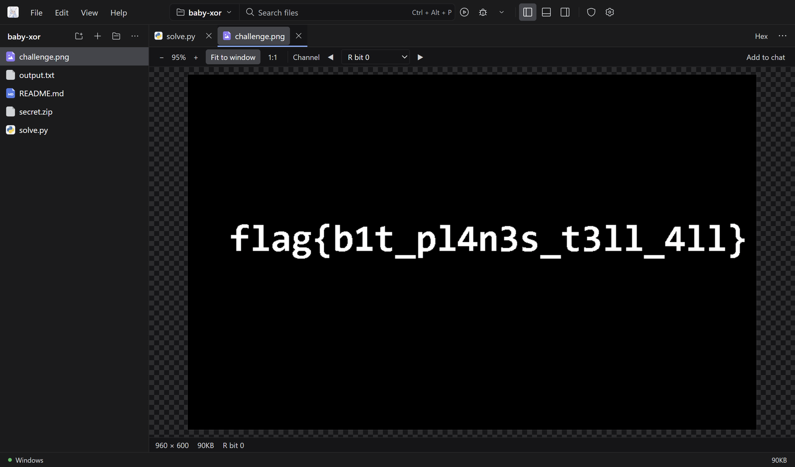
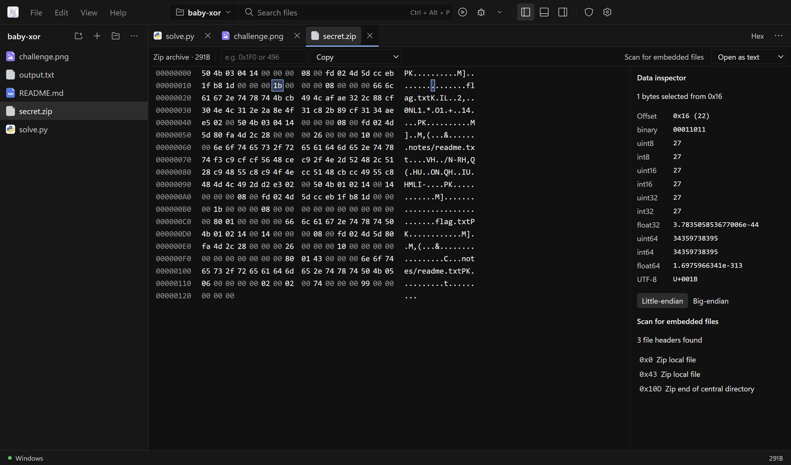
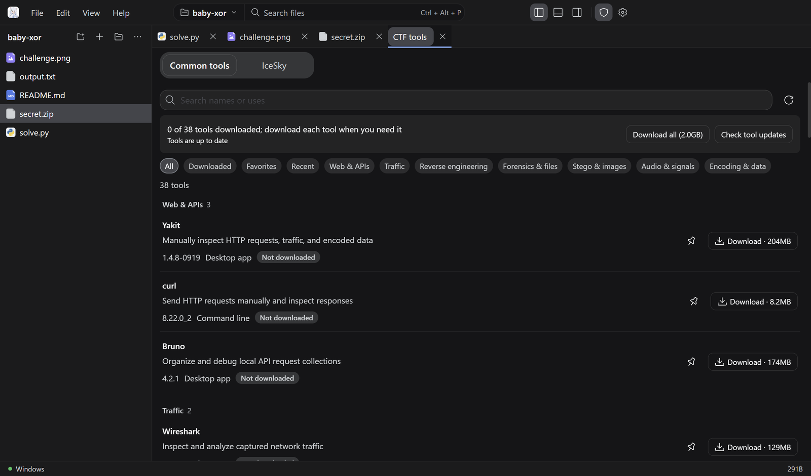

<div align="center">


# Rainy

**The AI agent workbench for CTF on Windows. Write the solve script, run it, ask the AI why it fails, and open any of 66 security tools without leaving the window.**

[](https://github.com/RainyMarks/Rainy/releases/latest)
[](https://github.com/RainyMarks/Rainy/releases)

[](LICENSE)
[](https://x.com/RainyMarksqwq)

English | [中文](README.zh.md)

[**Download for Windows (188 MB)**](https://github.com/RainyMarks/Rainy/releases/latest) · [What's new](#whats-new) · [Quick start](#run) · [Connect a model](#connect-a-model) · [Build from source](#run-from-source)

</div>


Rainy puts an AI coding agent, a real editor and debugger with AI suggestions and Ctrl+K edits, and a 66-tool CTF kit in one desktop app. The agent reads and edits your project and runs commands, asking first by default, and you review every file it changed: keep or undo each change. A project map shows how any codebase fits together and which files the agent is working on. Bring any model: DeepSeek, Claude, any OpenAI- or Anthropic-compatible API, a local server, or Strata local inference on an NVIDIA GPU. Run everything in native Windows or switch the project to WSL2 when a challenge needs Linux. Free for personal use. Developed by RainyMarks.

## Why Rainy

| | |
|---|---|
| **An agent you stay in control of** | The assistant reads, searches and edits project files, runs commands, and remembers the project across chats. Each chat runs read-only, asks before commands (the default), or runs fully automatically. Every file it changes is listed for review in the editor, where you keep or undo each change. Add skills in `.rainy/skills` and MCP servers (including an IDA preset) in Settings. |
| **See the whole project** | The project map draws a project's parts and the imports between them, or every file as a block sized by its lines. It names the stack, explains each part with AI on request, and highlights the files the agent is reading or changing. |
| **66 CTF tools, one click each** | Wireshark, CyberChef, IDA, x64dbg, ImHex, JADX, Hashcat, sqlmap, Volatility 3 and more, sorted into Misc, Web and Reverse. Each tool downloads on its own, remains installed offline, and updates only when it changes. |
| **See inside any file** | Images open with zoom, pixel colors and one-click color channels and bit planes. Binaries open in a hex view with a data inspector and a binwalk-style scan for embedded files. Markdown, PDF, audio and video preview in place. |
| **A real editor and debugger** | AI suggestions as you type (Tab accepts) and Ctrl+K to rewrite a selection, reviewed line by line before you keep it. Search and replace across the project, a command palette, and Git with AI-written commit messages. CodeMirror 6 with completion, hover, go to definition, rename, diagnostics, diffs and recovery of unsaved work. Run and debug Python, JavaScript/TypeScript and C/C++; run PHP. |
| **Windows or WSL2** | Start in native Windows; move a project to a WSL2 environment whenever a challenge needs Linux tools. |
| **Your model, your keys** | Keys stay on your machine, encrypted with Windows data protection. Model requests follow the system proxy or one you set. There is no telemetry; crash reports stay local. |
| **Light** | A 188 MB installer. Tools, the Strata engine, PHP and the WSL runtime download only when you need them. |

<a id="tour"></a>
## A quick look

**Review what the AI changed.** The files the agent changed are listed above the message box. Open one to see each change in the editor and keep or undo it; whatever is left is kept when you send your next message.


**Map any project.** See a project's parts and how they depend on each other, the stack it uses, and what each part does, in a sentence the AI writes on request.


**Search, replace and commit.** Search every file of the project, preview a replacement before it happens, then stage and commit in the Git pane with a message the AI writes.


**Edit with AI in place.** Select code, press Ctrl+K and describe the change. The new lines appear in green, anything they replace in red, until you accept or reject them.


**Stego in one click.** Step through color channels and bit planes; this flag hides in bit 0 of the red channel.



**Hex view with an inspector.** Read any byte as integers, floats or UTF-8, and scan the whole file for embedded PNG, ZIP, ELF and other headers.



**Tools when you need them.** Search the catalog by name or use, and download only what the challenge needs.



<a id="whats-new"></a>
## What's new in 2.5

- **Search and replace across the project** (Ctrl+Shift+F, Ctrl+Shift+H):
  - Results appear as you type, grouped by file, with match case, whole word and regular expressions, and files to include or exclude.
  - A click opens the file with the match selected.
  - Replace shows each match crossed out with its replacement before anything changes; replace all, or one file at a time. Files with unsaved edits are changed in the editor, so nothing you typed is lost.
- **Source control** (Ctrl+Shift+G):
  - Staged changes and changes, with the branch and how far it is ahead or behind. Stage, unstage or discard one file or all of them; a click shows the diff.
  - **AI** writes the commit message from the staged changes, in the style of your recent commits. When nothing is staged, one click stages everything and commits.
  - Works with an installed Git, or with the Git in the Windows basic environment. The status bar shows the branch, and the tab how many files changed.
- **Command palette** (Ctrl+Shift+P or F1): run nearly fifty commands by name, with their shortcuts; recently used ones come first. Typing > in quick open switches to it.
- The side pane switches between files, search and source control with the tabs at its top.
- Faster on Windows: a finished background program no longer waits about 1.5 s while Rainy stops it a second time, so the project map opens sooner.

## What's new in 2.4

- **Project map**: open it from the top bar to see any project at a glance.
  - Architecture: the project's parts as boxes, each above the parts it imports, so the foundations sit at the bottom. Double-click a part to look inside it.
  - Files: every file as a block sized by its lines and colored by its language.
  - The stack (languages, frameworks and tools) is named from manifests and imports. **Explain with AI** describes the project and each part in a sentence with one model request, and the answer is kept.
  - While the agent works, the files it is reading or changing light up on the map and in the file tree.
- **Review the AI's changes**:
  - The files the agent changed in a chat are listed above the message box, with the lines added and removed.
  - **Review** marks each change in the editor; keep or undo each one, or all of them at once.
  - Changes are kept automatically when you send your next message, so you never have to click Keep. Turn this off in **Settings → Security** to keep the list until you keep or undo each change.
- **Ask the AI from anywhere**: **Fix with AI** next to each problem, and a terminal button that sends the output (or the selection) to the AI.
- **A steadier chat**:
  - A request that fails for a passing reason (overload, rate limit, a dropped connection) is retried automatically, with a countdown and **Retry now**.
  - Thinking shows how long it took.
  - Scrolling up while a reply streams keeps your place.
  - With Chinese and other input methods, Enter and Esc pick or drop a candidate in every text field instead of sending or closing.

## What's new in 2.3

- **AI in the editor**:
  - Suggestions as you type: pause, and a grey suggestion appears after the cursor. Tab accepts it, Ctrl+Right takes one word, Esc dismisses it.
  - Suggestions are off by default because each one is a model request. Turn them on in **Settings → Models** or from the status bar, and pick a fast, inexpensive model for them.
  - Ctrl+K edits: select code (or place the cursor), press Ctrl+K or choose **Edit with AI** from the context menu, and describe the change.
  - The new code streams into the editor. Only the lines that changed are marked; Ctrl+Enter accepts and Esc puts the original back.
- **66 CTF tools**, including Hashcat, sqlmap, Volatility 3, MemProcFS, RetDec and pycdc, now sorted into three groups: Misc, Web and Reverse.

## What's new in 2.2

- **RainyAgent is now Rainy**, with a new icon. 2.2 installs over earlier versions and keeps your settings, chats and tools. The repository is now RainyMarks/Rainy; old links still work.
- **Appearance settings**:
  - Seven color schemes: Graphite, Slate, Midnight, Sand, Forest, Rose and Pure black.
  - An accent color for links, switches and focus rings, or the scheme's own.
  - Interface and code fonts, chosen from the fonts installed on your PC or typed in.
  - The editor, terminal and AI security toolkit follow your choices.
- **A calmer look**: neutral grays, semibold titles, filled buttons, and a larger Settings window with a title on every page, grouped cards and segmented choices.
- **2.2.1**: the license is now the Rainy Source Available License, held by RainyMarks; its terms are unchanged.

## What's new in 2.1

- **VS Code-style previews**:
  - Images with channels and bit planes.
  - Markdown with source, preview and split views.
  - PDF, audio and video.
  - A hex view for any file, with a data inspector and an embedded-file scan.
  - GBK and UTF-16 text.
- **AI you control**:
  - Read-only, ask, and full auto permission modes, with an approval bar for commands, MCP tools and writes outside the project.
  - One-click undo of the agent's file changes.
  - New file search and content search tools.
- **Network and privacy**:
  - Model requests follow the system proxy (including PAC) or one you set.
  - API keys are encrypted with Windows data protection.
  - Crash reports stay local, and Settings can export a scrubbed diagnostics zip.
- **35% smaller installer**: 189 MB (293 MB for 2.0).
- **2.1.1**:
  - Save errors in Settings are explained beside the button.
  - Open chats keep their own permission mode.
  - Model changes reach open chats at once.
  - About 40 smaller fixes.
  - See the [release notes](https://github.com/RainyMarks/Rainy/releases/tag/v2.1.1).
- **2.1.2**: squarer corners throughout, and the browser workbench is now the **AI security toolkit**.

Upgrading from 1.x: on first start Rainy imports your saved models, API keys and global prompt. Chats from 1.x use an older format and are not imported.

<a id="run"></a>
## Download and start

1. Download [the latest Windows x64 installer](https://github.com/RainyMarks/Rainy/releases/latest) and install it. No activation code is required.
2. Open Rainy from the desktop shortcut and choose **File → Open folder**.
3. Connect a model in **Settings → Models** (see [Connect a model](#connect-a-model)), then open **AI assistant** on the right.
4. Open **CTF tools → Common tools** and download the tools you need, or select **Download all**. Downloaded tools also work offline.

| Optional download | Size | Where |
|---|---|---|
| Strata engine | about 560 MB | **Settings → Runtime environments → Optional components** |
| PHP | about 38 MB | **Settings → Runtime environments → Optional components** |
| WSL runtime | about 296 MB | Downloaded automatically on the first WSL launch |
| CTF tools | Size varies by tool and is shown before download | **CTF tools → Common tools** |

Rainy checks for stable releases and downloads them in the background. A downloaded update offers **Later** or **Restart and install**; ordinary exit does not install it, and updates never download your tools again. See [tool installation and updates](docs/desktop.md#ctf-workbench) for details.

<a id="connect-a-model"></a>
## Connect a model

### Existing server or API

1. Open **Settings → Models** and enter a provider ID, Base URL, protocol, and a key when required.
2. Select **Discover models** or enter the model ID manually.
3. Set the service's actual context window and output limit, save, then run the streaming and tool-call check.

The selected Windows or WSL environment must be able to reach the service. Keys are stored encrypted in that environment's private credential store, and Rainy never silently switches to another model.

The model list includes presets for **DeepSeek V4.1 Flash**, **Claude Opus 5.5** and **Claude Haiku 5.5**: select **Load**, enter your API key and save. Both Claude presets share one Anthropic key. The Haiku preset uses a 100K window so each request stays in Claude Haiku 5.5's lower price tier. A relay works the same way: keep the `anthropic-messages` protocol and the Claude model ID (for example `claude-opus-5-5`, `claude-sonnet-5-5` or `claude-haiku-5-5`), and Rainy applies that model's adaptive thinking and effort levels. Claude sessions keep the prompt cache for an hour, so continuing a conversation reads the earlier context from the cache.

### Strata local model

The Strata engine runs [Niko1221/Strata 0.1.39](https://github.com/Niko1221/Strata/releases/tag/v0.1.39) with Python 3.12.14 on Windows x64 with NVIDIA CUDA 13 (driver 580 or newer; GPU targets `sm75`, `sm86`, `sm89`, `sm120`). AMD and Linux inference are not provided. You supply a supported Qwen3.8 Flash Next main GGUF with all of its shards and the matching MTP weights; model weights are not bundled.

1. Open **Settings → Models → Strata local model**. Download the engine first if it is missing, then choose the main model and MTP files or import a Strata profile.
2. Save the context window and local port, then select **Start local model**. Preparation runs locally and can be cancelled.
3. When the model is ready, select **Connect and use by default**.

If a WSL environment under NAT cannot reach the Windows loopback server, use the Windows execution environment for Strata. See the [desktop guide](docs/desktop.md#strata-local-inference) and the [Chinese setup guide](docs/desktop-setup.zh-CN.md) for resource controls and validation scope.

<a id="run-from-source"></a>
## Build from source

Building the Windows release requires Node.js `^22.19 || >=24`, pnpm `11.7.0`, and the Windows/WSL prerequisites in the [build guide](docs/desktop-setup.zh-CN.md#从源码构建). Pinned binaries such as `build-inputs/strata-runtime.tar.gz` are restored from release assets by the bootstrap command rather than stored in Git.

```powershell
git clone https://github.com/RainyMarks/Rainy.git
cd Rainy
pnpm install --frozen-lockfile
node scripts/bootstrap-release-inputs.mjs --manifest toolpacks/build-inputs.v1.json
powershell.exe -NoProfile -ExecutionPolicy Bypass -File scripts/package.ps1 -Distribution Ubuntu -ReuseNativeToolsRelease release/offline-2.5.0 -ComponentSource release/offline-2.5.0/environment-components
```

Replace `Ubuntu` only when your WSL build distribution has another name, and `2.5.0` with the version in `package.json`. [Validation](docs/validation.md) records the build, installation and runtime checks completed for each release.

For development, `pnpm run dev` builds the app and starts a Host without Electron, then prints a URL you can open in a browser; `pnpm run start` runs Electron on the built files.

## Support the project

If Rainy helped you solve a challenge, a ⭐ on this repository helps other players find it. Follow [@RainyMarksqwq](https://x.com/RainyMarksqwq) on X for releases and CTF tips. Bug reports and feature requests are welcome in [GitHub Issues](https://github.com/RainyMarks/Rainy/issues).

## License and attribution

Rainy integration code uses the [Rainy Source Available License 1.0](LICENSE.Rainy). Personal and internal business use, modification, and noncommercial redistribution are free; sale, paid hosting, and commercial redistribution require written permission. This is a source-available project, not an OSI-approved open-source distribution. See [license scope](LICENSE) and [third-party notices](THIRD_PARTY_NOTICES.md).

Developers can start with the [architecture](docs/architecture.md) and [AGENTS.md](AGENTS.md).
