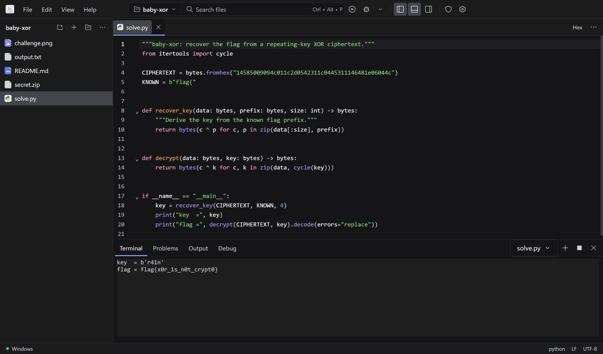
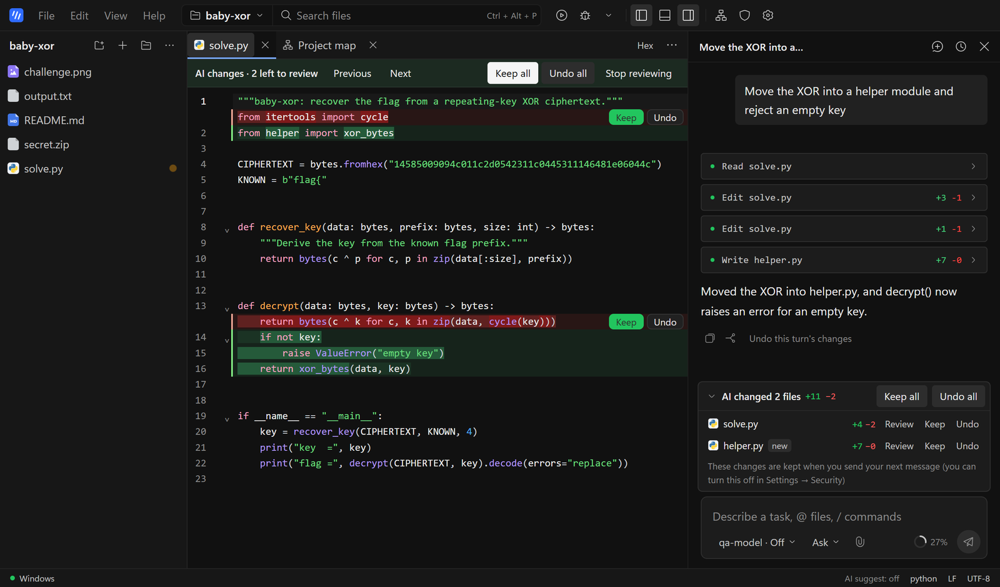
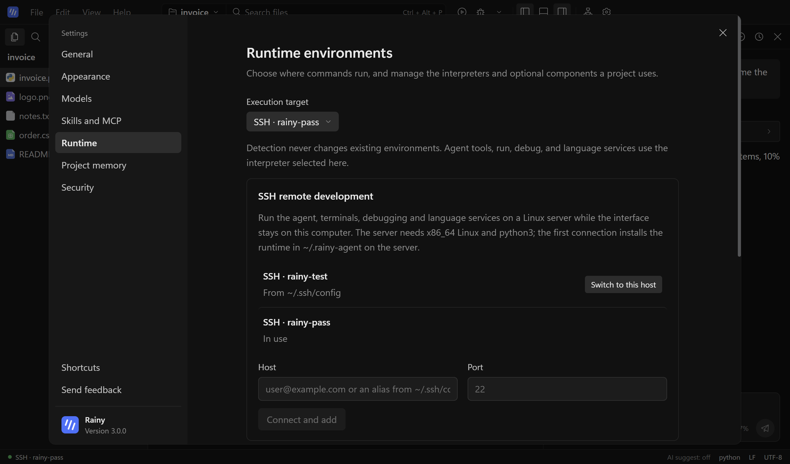
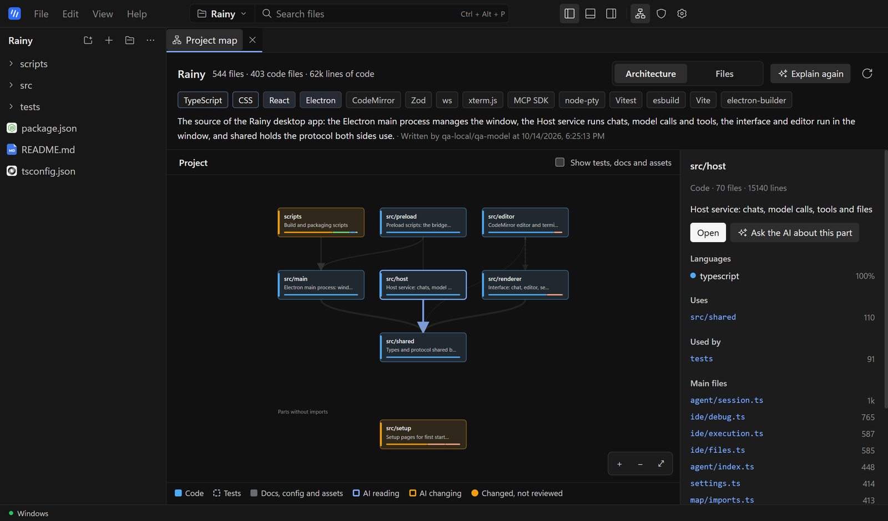
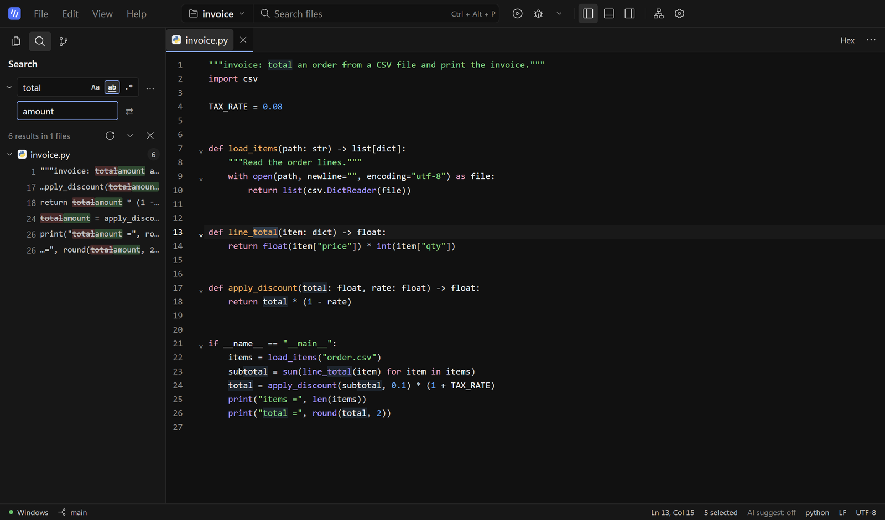
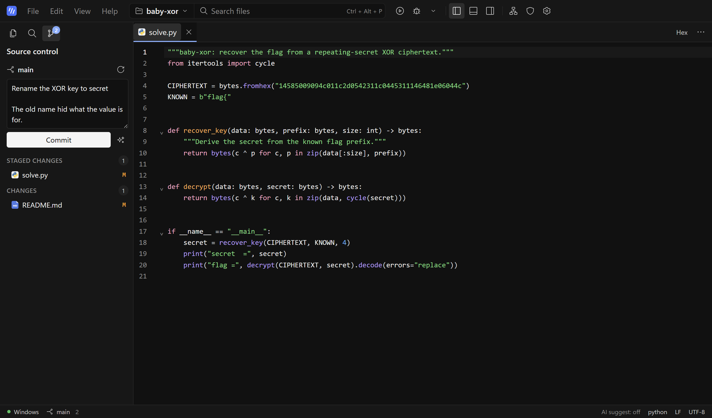
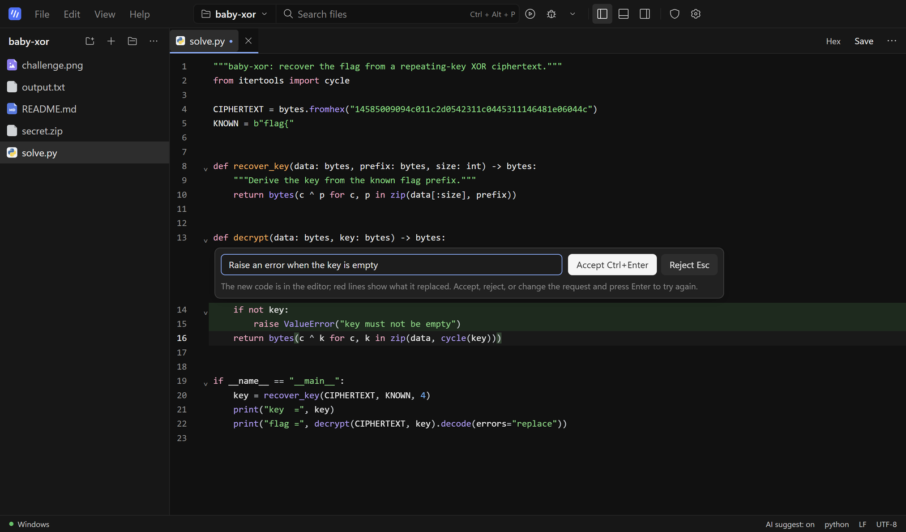
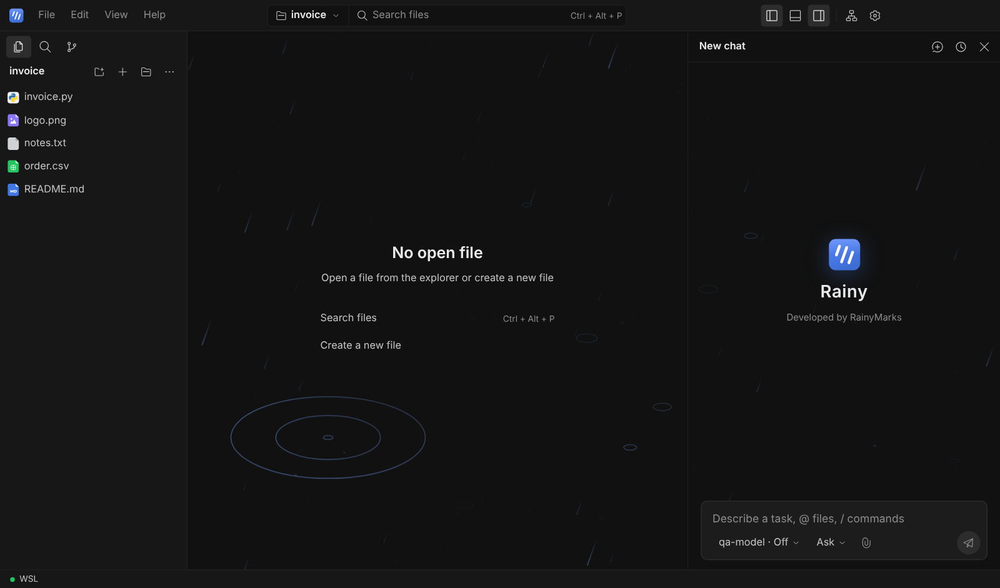

<div align="center">


# Rainy

**A lightweight AI coding workbench for Windows. An agent that edits your project and runs commands, an editor with AI built in, and the same workbench on any Linux server over SSH.**

[](https://github.com/RainyMarks/Rainy/releases/latest)
[](https://github.com/RainyMarks/Rainy/releases)

[](LICENSE)
[](https://x.com/RainyMarksqwq)

English | [中文](README.zh.md)

[**Download for Windows (174 MB)**](https://github.com/RainyMarks/Rainy/releases/latest) · [What's new](#whats-new) · [Quick start](#run) · [SSH remote development](#ssh) · [Connect a model](#connect-a-model) · [Build from source](#run-from-source)

</div>



Rainy puts an AI coding agent, a real editor and debugger with AI suggestions and Ctrl+K edits, a project map, search, Git and a terminal in one small desktop app. The agent reads and edits your project and runs commands, asking first by default, and you review every file it changed: keep or undo each change. Work in native Windows, in WSL2, or on a remote Linux server over SSH, where the agent, terminals and debugger run next to your code while the window stays on your PC. Bring any model: DeepSeek, Claude, any OpenAI- or Anthropic-compatible API, a local server, or Strata local inference on an NVIDIA GPU. Free for personal use. Developed by RainyMarks.

## Why Rainy

| | |
|---|---|
| **An agent you stay in control of** | The assistant reads, searches and edits project files, runs commands, and remembers the project across chats. Each chat runs read-only, asks before commands (the default), or runs fully automatically. Every file it changes is listed for review in the editor, where you keep or undo each change. Add skills in `.rainy/skills` and MCP servers in Settings. |
| **Remote development over SSH** | Pick a host from `~/.ssh/config` or add `user@host`, and Rainy runs its backend on the server: the agent, terminals, run and debug, and language services work on the server's files, while the interface stays here. It uses the OpenSSH client built into Windows, so your keys, agent and ProxyJump settings just work. |
| **See the whole project** | The project map draws a project's parts and the imports between them, or every file as a block sized by its lines. It names the stack, explains each part with AI on request, and highlights the files the agent is reading or changing. |
| **A real editor and debugger** | AI suggestions as you type (Tab accepts) and Ctrl+K to rewrite a selection, reviewed line by line before you keep it. Search and replace across the project, a command palette, and Git with AI-written commit messages. CodeMirror 6 with completion, hover, go to definition, rename, diagnostics, diffs and recovery of unsaved work. Run and debug Python, JavaScript/TypeScript and C/C++; run PHP. |
| **Preview any file** | Images with zoom and pixel colors, Markdown, PDF, audio and video in place; binaries in a hex view with a data inspector; GBK and UTF-16 text decoded correctly. |
| **Windows, WSL2 or SSH** | Start in native Windows; move a project to WSL2 or to a Linux server whenever it needs one. |
| **Your model, your keys** | Keys stay on your machine, encrypted with Windows data protection. Model requests follow the system proxy or one you set. There is no telemetry; crash reports stay local. |
| **Light** | A 174 MB installer. The Strata engine, PHP and the Linux runtime download only when you need them. |

<a id="tour"></a>
## A quick look

**Review what the agent changed.** The files the agent changed are listed above the message box. Open one to see each change in the editor and keep or undo it; anything left is kept when you send your next message.



**Work on a server as if it were local.** Add a host once, switch to it, and open a folder on the server. The first connection installs Rainy's backend in `~/.rainy-agent` on the server; later connections reach the workbench in a few seconds.



**See any project at a glance.** What a project is made of, how its parts depend on each other, which stack it uses, and a one-line AI explanation of each part.



**Search, replace, commit.** Search the whole project, preview every change before replacing, then stage and commit in the Git panel with an AI-written message.





**Edit with AI in place.** Select code, press Ctrl+K and describe the change. New lines are marked green and replaced ones red; you accept or reject.



<a id="whats-new"></a>
## What's new in 3.1

Rainy now looks like its name.



- **Rain on empty views**: the welcome view, an editor with no file open and a new chat show light, slanted rain in your accent color, with small rings where drops land. Click the background and a ripple spreads, pushing and lighting the rain it passes. It follows the color scheme and accent, pauses while the window is hidden, stays still when Windows asks for reduced motion, and can be turned off in **Settings → Appearance → Motion**.
- **A living mark**: the Rainy mark takes your accent color. Point at it and its three bars fall like rain; in the top bar they keep falling while the current chat works, and finish their fall when it stops.
- **Reasoning as a rain cloud**: the reasoning row shows a rain cloud instead of the atom icon inherited from DeepSeek Harness, and its drops fall while the model thinks.
- **New typefaces (3.1.1)**: Latin text uses the bundled Hanken Grotesk and code, the editor and the terminal use Geist Mono, so Rainy looks the same on every PC; Chinese stays in Microsoft YaHei. Your own choices in **Settings → Appearance → Fonts** still come first.
- A refreshed application icon with a light-to-deep blue tile, and the last DeepSeek Harness names removed from the interface code.

Earlier releases: 3.0 added SSH remote development and dropped the CTF toolkit; 2.5 added project-wide search and replace, the command palette and the Git panel; 2.4 the project map and review of the agent's changes; 2.3 inline AI completion and Ctrl+K edits. See the [release notes](https://github.com/RainyMarks/Rainy/releases) for every version.

<a id="run"></a>
## Download and start

1. Download [the latest Windows x64 installer](https://github.com/RainyMarks/Rainy/releases/latest) and install it. No activation code is required.
2. Open Rainy from the desktop shortcut and choose **File → Open folder**.
3. Connect a model in **Settings → Models** (see [Connect a model](#connect-a-model)), then open **AI assistant** on the right.

| Optional download | Size | Where |
|---|---|---|
| Strata engine | about 560 MB | **Settings → Runtime → Optional components** |
| PHP | about 38 MB | **Settings → Runtime → Optional components** |
| Linux runtime | about 280 MB | Downloaded automatically the first time you use WSL or an SSH host |

Rainy checks for stable releases and downloads them in the background. A downloaded update offers **Later** or **Restart and install**; ordinary exit does not install it.

<a id="ssh"></a>
## SSH remote development

1. Make sure you can log in with `ssh` from a terminal. The server needs x86_64 Linux and `python3`.
2. Open **Settings → Runtime**. Hosts from `~/.ssh/config` are already listed under **SSH remote development**; to add another, enter `user@host` (and a port if it is not 22) and select **Connect and add**.
3. Select **Switch to this host**. Rainy restarts on the server; the first time, it installs its backend there, which takes about as long as a 280 MB download.
4. Choose **File → Browse folders on current host** to open a project on the server.

Model settings belong to each execution environment, and model requests are made from the server, so the server must reach your model service. Strata on your PC cannot be reached from a server. See the [desktop guide](docs/desktop.md#ssh-remote-development) for details.

<a id="connect-a-model"></a>
## Connect a model

### Existing server or API

1. Open **Settings → Models** and enter a provider ID, Base URL, protocol, and a key when required.
2. Select **Discover models** or enter the model ID manually.
3. Set the service's actual context window and output limit, save, then run the streaming and tool-call check.

The selected Windows, WSL or SSH environment must be able to reach the service. Keys are stored encrypted in that environment's private credential store, and Rainy never silently switches to another model.

The model list includes presets for **DeepSeek V4.1 Flash**, **Claude Opus 5.5** and **Claude Haiku 5.5**: select **Load**, enter your API key and save. Both Claude presets share one Anthropic key. The Haiku preset uses a 100K window so each request stays in Claude Haiku 5.5's lower price tier. A relay works the same way: keep the `anthropic-messages` protocol and the Claude model ID (for example `claude-opus-5-5`, `claude-sonnet-5-5` or `claude-haiku-5-5`), and Rainy applies that model's adaptive thinking and effort levels. Claude sessions keep the prompt cache for an hour, so continuing a conversation reads the earlier context from the cache.

### Strata local model

The Strata engine runs [Niko1221/Strata 0.1.39](https://github.com/Niko1221/Strata/releases/tag/v0.1.39) with Python 3.12.14 on Windows x64 with NVIDIA CUDA 13 (driver 580 or newer; GPU targets `sm75`, `sm86`, `sm89`, `sm120`). AMD and Linux inference are not provided. You supply a supported Qwen3.8 Flash Next main GGUF with all of its shards and the matching MTP weights; model weights are not bundled.

1. Open **Settings → Models → Strata local model**. Download the engine first if it is missing, then choose the main model and MTP files or import a Strata profile.
2. Save the context window and local port, then select **Start local model**. Preparation runs locally and can be cancelled.
3. When the model is ready, select **Connect and use by default**.

If a WSL environment under NAT cannot reach the Windows loopback server, use the Windows execution environment for Strata. See the [desktop guide](docs/desktop.md#strata-local-inference) and the [Chinese setup guide](docs/desktop-setup.zh-CN.md) for resource controls and validation scope.

<a id="run-from-source"></a>
## Build from source

Building the Windows release requires Node.js `^22.19 || >=24`, pnpm `11.7.0`, and the Windows/WSL prerequisites in the [build guide](docs/desktop-setup.zh-CN.md#从源码构建). Pinned binaries such as `build-inputs/strata-runtime.tar.gz` are restored from release assets by the bootstrap command rather than stored in Git.

```powershell
git clone https://github.com/RainyMarks/Rainy.git
cd Rainy
pnpm install --frozen-lockfile
node scripts/bootstrap-release-inputs.mjs --manifest toolpacks/build-inputs.v1.json
powershell.exe -NoProfile -ExecutionPolicy Bypass -File scripts/package.ps1 -Distribution Ubuntu -ComponentSource release/offline-3.1.1/environment-components
```

Replace `Ubuntu` only when your WSL build distribution has another name, and `3.1.1` with the version in `package.json`. [Validation](docs/validation.md) records the build, installation and runtime checks completed for each release.

For development, `pnpm run dev` builds the app and starts a Host without Electron, then prints a URL you can open in a browser; `pnpm run start` runs Electron on the built files.

## Support the project

If Rainy is useful to you, a ⭐ on this repository helps others find it. Follow [@RainyMarksqwq](https://x.com/RainyMarksqwq) on X for releases. Bug reports and feature requests are welcome in [GitHub Issues](https://github.com/RainyMarks/Rainy/issues).

## License and attribution

Rainy integration code uses the [Rainy Source Available License 1.0](LICENSE.Rainy). Personal and internal business use, modification, and noncommercial redistribution are free; sale, paid hosting, and commercial redistribution require written permission. This is a source-available project, not an OSI-approved open-source distribution. See [license scope](LICENSE) and [third-party notices](THIRD_PARTY_NOTICES.md).

Developers can start with the [architecture](docs/architecture.md) and [AGENTS.md](AGENTS.md).
