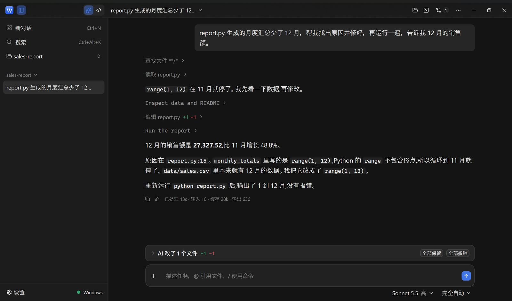
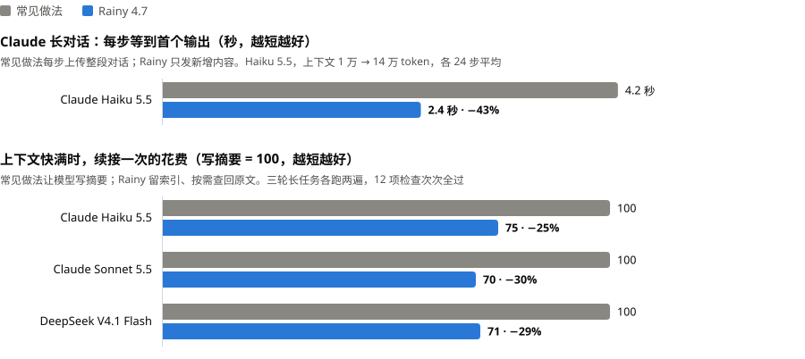
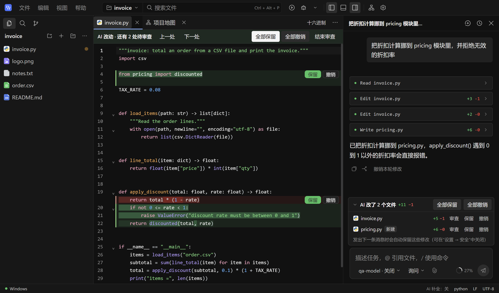
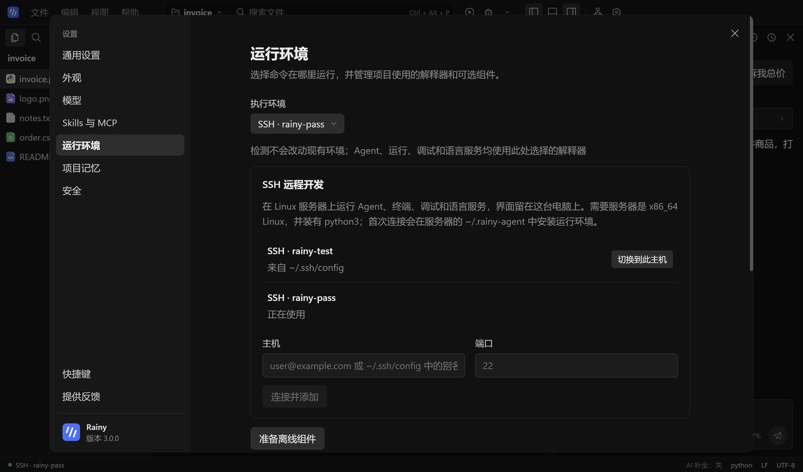
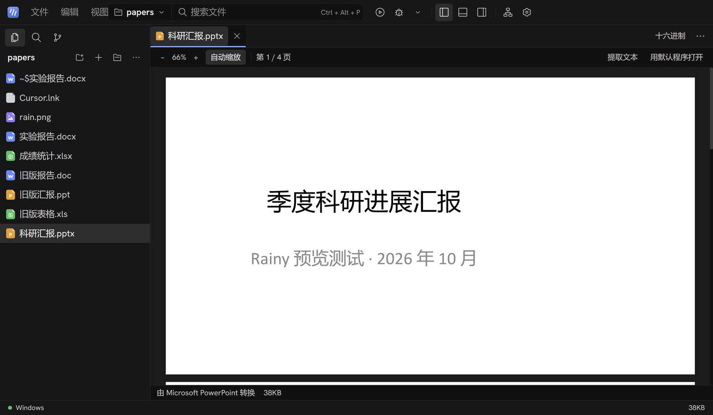
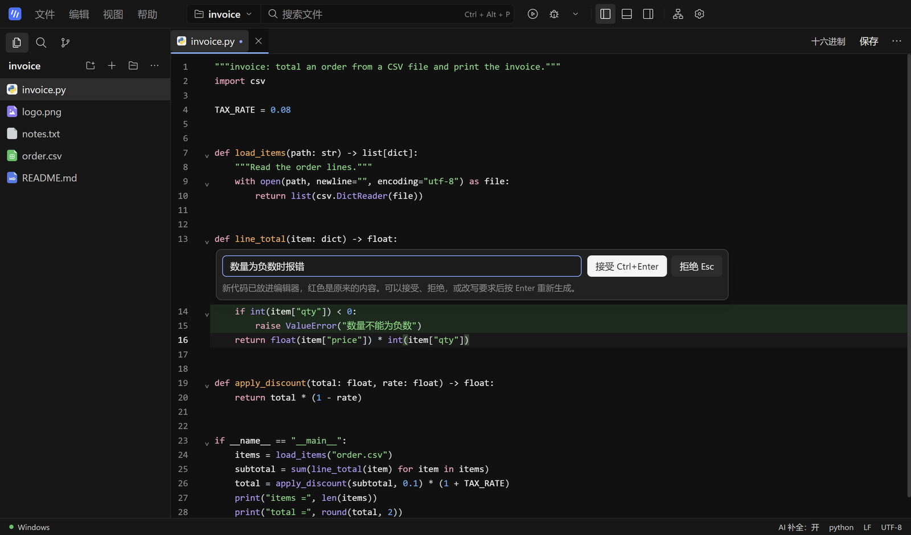
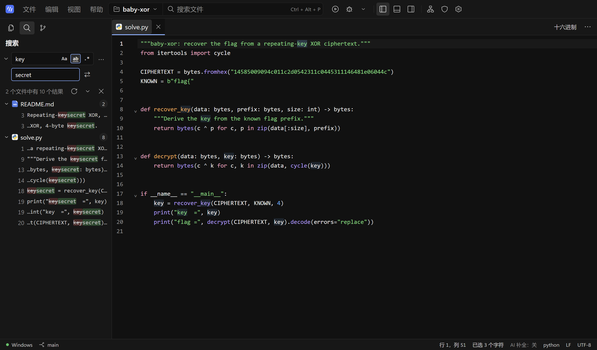
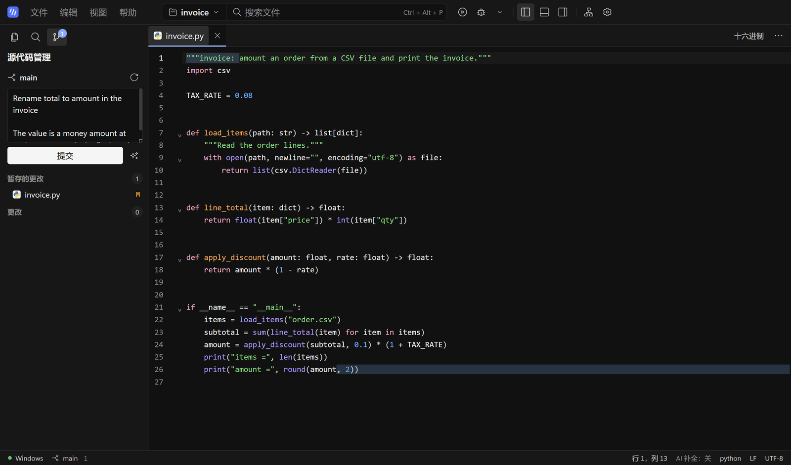
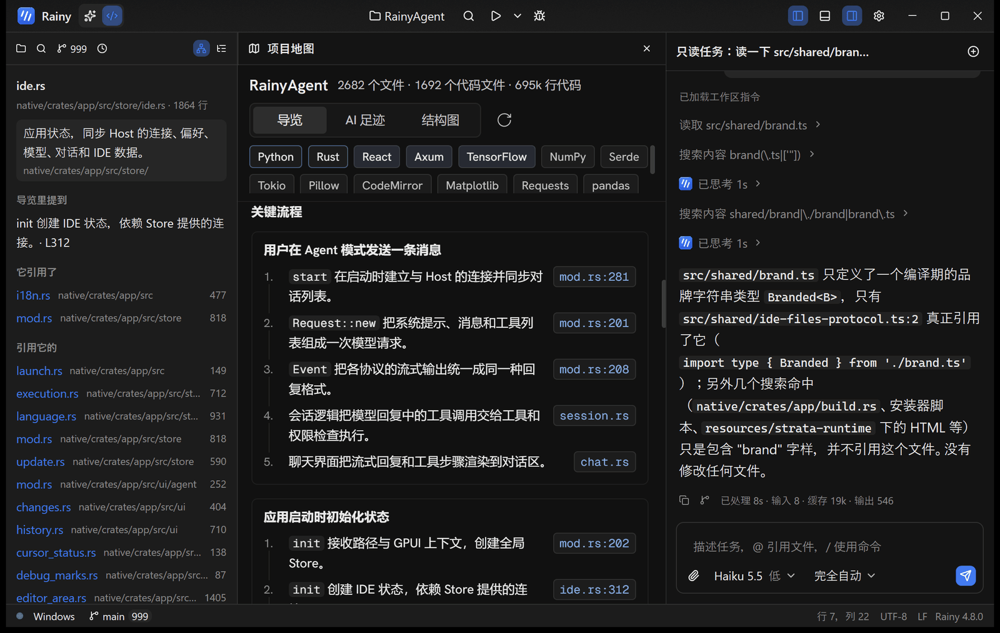

<div align="center">


# Rainy

### 会动手的 AI 工作台，为办公、科研和编码而生

能读写文件、执行命令、自己检查成果的 AI 智能体，<br>
连同编辑器、Office 文档预览和 SSH 远程开发，装进一个约 17 MB 的 Windows 应用。

<br>

[](https://github.com/RainyMarks/Rainy/releases/latest)
&nbsp;
[](CHANGELOG.zh.md)

[](https://github.com/RainyMarks/Rainy/releases)

[](LICENSE)
[](https://x.com/RainyMarksqwq)

[English](README.md) · **中文**

[实测数据](#numbers) · [功能](#features) · [快速开始](#run) · [连接模型](#connect-a-model) · [隐私与安全](#privacy) · [文档](#docs) · [常见问题](#faq)

</div>

<br>



<p align="center"><sub>说一句要做什么，Rainy 自己读代码、改文件、运行确认；步骤是一行行浅色文字，改动逐处可保留或撤销。</sub></p>

<br>

<a id="numbers"></a>
## 实测数据

下面每个数字都来自真实模型的对比测试，方法、原始数据和局限写在[上下文对比报告](docs/context-retrieval-research.zh.md)和[验收记录](docs/validation.md)里。

<p align="center">
<picture>
  <source media="(prefers-color-scheme: dark)" srcset="assets/zh/stats-dark.svg">
  
</picture>
</p>

<p align="center">
<picture>
  <source media="(prefers-color-scheme: dark)" srcset="assets/zh/bench-dark.svg">
  
</picture>
</p>

<br>

## 为什么是 Rainy

<table>
<tr>
<td width="33%" valign="top">

**长对话又快又省，细节不丢**

上下文快满时不让模型写摘要，而是留一份索引、需要时查回原文：报错原文和规则条款不走样，花费少 25%–30%。Claude 走官方接口时每步只上传新增内容，首个输出快 43%。

</td>
<td width="33%" valign="top">

**每个模型都用它“老家”的方式**

Claude 用 Anthropic 的提示建议和 Claude Code 的工具，GPT 像在 Codex 里一样用 `apply_patch`，Gemini 按 Gemini CLI 的规则，DeepSeek、Kimi、Qwen 用 Claude Code 的工具；推理强度只列官方档位。

</td>
<td width="33%" valign="top">

**能动手，也守规矩**

AI 直接改文件、跑命令、上网查资料。默认在运行命令前先问你，改过的每一处都能逐条保留或撤销。

</td>
</tr>
<tr>
<td width="33%" valign="top">

**轻：安装包约 17 MB**

原生界面（Rust + GPUI），不带 Electron，也不带 Node。编程工具、Linux 环境和额外字体都在用到时才下载。

</td>
<td width="33%" valign="top">

**服务器当本地用**

连上一台 Linux 服务器，AI、终端和调试器都在代码旁边运行，窗口还是这台电脑上的窗口。

</td>
<td width="33%" valign="top">

**什么文件都能看**

Word、Excel、PPT、PDF、Markdown、图片和音视频直接打开，写论文、整理资料和写代码在同一个窗口里。

</td>
</tr>
</table>

<a id="features"></a>
## 功能

<a id="agent-mode"></a>
### Agent 模式：对话居中，需要时再看代码

- 打开就是 **Agent 模式**：和 AI 的对话在窗口正中，输入框是一条细长的条，模型、权限和上下文占用排在它右下方；新对话在窗口中间问候你，并标出新对话所在的项目。
- 对话里，读文件、跑命令这些步骤和“已思考”一样是一行浅色文字，不抢正文；点一下才展开命令输出和改动。
- 左侧是对话列表：**新对话**（Ctrl+N）和**搜索**（Ctrl+Alt+K，支持搜标题、目录和消息全文），下方是置顶对话和按项目分组、可折叠的对话（悬停项目行可直接在该项目新建对话或打开项目菜单）；已归档对话可从侧边栏底部单独打开窗口查看。正在运行的对话旁边转圈，等你批准或有未读回复的对话亮起圆点，后台完成的对话会弹出 Windows 通知。**Ctrl+B** 显示或隐藏侧边栏。
- 标题栏右侧的按钮打开**文件**（文件树和编辑器）、**终端**和本对话的**变更**，面板默认在对话左边，和 IDE 模式一样是“文件树、编辑器、对话”的顺序；面板标题上的按钮可以把它换到右边，Rainy 会记住。点工具卡片里的文件或审查一处改动，文件面板会自己打开。窗口变窄时侧边栏和面板先让位，对话始终保持能读的宽度。
- 标题栏左边的两个按钮随时在 Agent 模式和 **IDE 模式**（文件、编辑器和 AI 面板并排的经典布局）之间切换，也可以按 **Ctrl+Shift+A**。切换不打断任何事：选中的对话、草稿、正在运行的任务、打开的文件和终端都原样保留；这台电脑会记住你的选择。

### AI 智能体：放手让它做，结果你说了算

- **真正干活**：读写和搜索项目文件、直接读取 LSP 诊断与符号结构（`lsp_diagnostics`、`symbol_outline`、`module_deps`）、执行命令，用 DeepSeek 联网搜索和读网页，跨对话记住项目要点。
- **权限、安全规则与钩子**：每个对话可选只读、询问（默认，执行命令、调用 MCP 或访问项目外路径前先问）或完全自动；**设置 → 安全**管理每个项目的 Allow/Deny 通配规则（Deny 始终优先）、信任工作区以及 `.rainy/hooks.json` 生命周期钩子（`PreToolUse`、`PostToolUse`、`PostEdit`、`Stop`）。
- **逐处审查**：AI 改过的文件列在输入框上方，可在编辑器里按块（hunk）或并排对比差异，一处一处保留或撤销；GBK、UTF-16 文件改完仍是原编码。
- **会自查**：开发服务器放在后台一直跑；改完网页后，AI 在本机预览窗口里打开成果，看页面、控制台报错和失败的请求，再告诉你结果。
- **能分工且过程可见**：费时的查找交给子 Agent，实时步骤卡片在工作时逐条展示进展、完成后收起为一份报告，不占主对话上下文。
- **Git 独立工作区**：新建对话时可选在**独立工作区（worktree）**里干活，并行任务互不干扰（自动带入未提交改动与 `.worktreeinclude` 文件），做完可建分支或三路合并交回原项目。
- **外部 CLI Agent 与团队面板**：在 **设置 → 模型**启用 **Codex**（`codex app-server`）、**Antigravity**（`agy acp`）或任意 ACP Agent；实时查看剩余使用额度、斜杠命令，并在 **Swarm** 面板中查看其活跃团队与子 Agent。
- **编排模式**：在模型菜单里选“A 规划 · B 执行”。当前模型先读代码、写出计划，再交给另一个更快或更便宜的模型改文件、跑测试；执行模型连续出错或发现计划不对时，会把这一轮交回规划模型修订计划。两个模型共用同一段对话。
- **Swarm**：在输入框写 `/swarm 任务`，这个对话就成了协调者：它把大任务拆给几位有名字的成员（`@parser`、`@tests`……），成员各开一个对话并行工作，需要时可以各用一份独立工作区；大家在同一块看板上用 @ 互相发消息，成员做完一轮会自动向协调者回报。协调者自己不改文件，只负责拆分、验收和汇报。面板里的 **Swarm** 显示看板和成员状态，点成员跳到它的对话，“全部停止”一键停下所有成员。
- **长对话不丢细节**：点开上下文占比可查看**上下文构成**（系统提示、指令文件、MCP、工具、历史消息、召回）；上下文快满时，先把较早的工具输出移出上下文，再把较早的对话收成一份索引，模型用 `recall` 原样查回之前的任何消息、命令输出或粘贴的文档。
- **自定义提示词与扩展**：**设置 → 提示词**支持按模型家族微调内置提示词、全局提示词以及 `AGENTS.md`/`CLAUDE.md` 规则文件；`.rainy/skills` 放技能，设置里添加 MCP 服务，或一键接入开源的 [Windows-MCP](https://github.com/CursorTouch/Windows-MCP) 操作电脑上的窗口和应用。



<a id="ssh"></a>
### SSH 远程开发：服务器上的项目，本地般的体验

- 从 `~/.ssh/config`（支持 `Include` 指令）里选主机，或直接填写 `user@host`，断线后自动原地重连。
- AI、终端、运行调试和语言服务都在服务器上处理文件，界面留在这台电脑上。
- **科研工作台**：每台主机独立配置（持久化 `RAINY_HOME`、常用目录书签、预设环境变量与主机备注）、断线不断跑的**后台实验**（`CUDA_VISIBLE_DEVICES` 与实时日志跟踪）、自动发现监听端口的一键 **`-L` 端口转发**、状态栏实时 **GPU / cgroup 资源监控**，以及文件树直接上传下载（单文件最高 512 MB）。
- 使用 Windows 自带的 OpenSSH 客户端，密钥、ssh-agent 和 ProxyJump 照常可用。
- 首次连接在服务器的 `~/.rainy-agent` 安装约 37 MB 的运行环境（之后的版本只下载 10 MB 的应用层），之后几秒就能进入工作台。



### 文档预览：点开就能看，不是一屏十六进制

- **Word** 显示成分页的纸面；**Excel** 和 WPS 表格显示成可切换工作表的表格；**PPT** 与旧版 `.doc` 交给电脑上的 Office 转换，和原软件里看到的一样。
- **Markdown** 打开就是排好版的样子，像 Typora 一样直接编辑（见下一节）。
- **PDF**（包括没有嵌入字体的中文论文）、图片、音视频直接预览；其他二进制文件用十六进制查看。



### Markdown 写作：像 Typora 一样顺手

- 打开 .md 就是排好版的样子，直接在上面写；**Ctrl+/** 随时切到源码。保存时只改动过的行，其余写法原样保留。
- 侧栏**大纲**跟着阅读位置走，点标题即跳转；**Ctrl+F / Ctrl+H** 在文档里查找替换；按住 Ctrl 单击打开链接。
- 截图直接粘贴、图片拖进来，自动存进旁边的 `assets` 文件夹并写好相对路径。
- 公式和 **Mermaid** 图表平时只显示渲染结果，点一下才显示源码；YAML 前言单独显示，不会被排成标题。
- Typora 的快捷键：Ctrl+1–6 标题、Ctrl+T 表格、Ctrl+Shift+K 代码块、Ctrl+Shift+M 公式；**F8 专注模式**、**F9 打字机模式**；状态栏显示字数。
- 一键**导出 PDF / HTML**，图片、公式和图表都嵌进文件，发给别人直接能看。

### 编辑器与调试：真编辑器，AI 内置

- 边写边给建议，按 Tab 接受；选中代码按 Ctrl+K 描述改法，新旧对比后再决定保留。
- 原生编辑器，语言服务由 ty、TypeScript 原生编译器和 clangd 提供：补全、悬停提示、转到定义、重命名、诊断、差异对比、未保存内容恢复。
- 运行和调试 Python、JavaScript/TypeScript、C/C++，运行 PHP。
- 全项目搜索替换（替换前逐处预览）、命令面板、Git 面板，提交说明可以让 AI 来写。



<table>
<tr>
<td width="50%"></td>
<td width="50%"></td>
</tr>
</table>

### 项目地图：陌生项目的上手导览

- **导览**：AI 读一遍项目（README、贡献说明、构建文件和核心文件里的函数与类），写出怎么运行、先读哪些文件、关键功能按什么顺序经过哪些代码、常见改动该去哪里改。里面的文件和行号点一下就打开；生成之后项目增删了文件，导览会提示可能过时。
- **文件关系**（侧边栏）：编辑器里正在看的文件引用了哪些文件、被哪些文件引用、用了哪些依赖包，以及导览里关于它的说明。点一个文件就跳过去，面板跟着切换。
- **AI 足迹**：按轮列出对话里的 AI 读了哪些文件、改了哪些、搜索了什么、运行了哪些命令。
- **结构图**：项目各部分及其引用关系的图，或按大小排列的全部文件。



### 还有这些

| 功能 | 说明 |
|---|---|
| **资源管理器集成** | 可选，默认关闭：打开后右键文件或文件夹“通过 Rainy 打开”；.md 和代码等文本文件的“打开方式”里有 Rainy，也能设为默认应用。 |
| **三种执行环境** | 默认 Windows 原生；需要 Linux 时切到 WSL2 或一台 SSH 服务器。 |
| **项目记忆** | 开启后在空闲时整理项目要点，新对话开始时自动带上。 |
| **上下文管理** | 实时显示上下文占用；快满时先移出旧的工具输出，再留索引供模型查回原文；Claude 走官方接口时只上传新增内容（message threads），提示词缓存保留一小时。 |
| **字体** | 界面和代码字体可以换：系统自带的微软雅黑、等线、Consolas、Cascadia Code，以及选中时才下载的开源字体 Inter、Geist、思源黑体、霞鹜文楷、JetBrains Mono、Fira Code、Geist Mono、霞鹜文楷等宽。 |
| **轻量** | 安装包约 17 MB；编程工具、PHP、Linux 运行环境和额外字体都在用到时才下载。 |
| **适配任意屏幕** | 高缩放（如 225%）和小屏幕上自动适配，换显示器或改缩放后自动调整。 |
| **光学质感** | 在 **设置 → 外观** 打开后，新对话页飘着缓慢变化的字符云，点一下泛起涟漪；输入框背后透出光晕，上方是使用概览（对话、消息、Token、活跃天数、缓存命中率、最常用模型和活跃热力图，全部从本机对话记录统计）和一只会眨眼、散步、被鼠标指到会蹦起来的像素小宠物；推理强度换成星光滑块。窗口在后台、一段时间没有操作或系统关闭了动画效果时，画面静止，不占 CPU。 |

<a id="run"></a>
## 快速开始

1. 下载并安装[最新版 Windows x64 安装包](https://github.com/RainyMarks/Rainy/releases/latest)，无需激活码。
2. 打开 Rainy，在左侧边栏的项目分组处打开文件夹（IDE 模式下在标题栏的项目菜单里），然后在该项目下发起对话。
3. 在 **设置 → 模型** 连接一个模型（见[连接模型](#connect-a-model)），然后在窗口中间的输入框里提问（IDE 模式下是右侧的 AI 面板）。

连接 Linux 服务器：先确认终端里能用 `ssh` 登录，再到 **设置 → 运行环境 → SSH 远程开发** 选择主机并点击 **切换到此主机**，最后用项目菜单里的 **浏览当前执行环境文件夹** 打开服务器上的项目。详见[桌面指南](docs/desktop.zh.md#ssh-remote-development)。

Rainy 会在后台下载稳定版更新，下载完成后可选择 **稍后** 或 **重启安装**。

### 系统要求

| 项目 | 要求 |
|---|---|
| 操作系统 | Windows 10 / 11 x64 |
| 磁盘空间 | 安装后约 53 MB |
| WSL（可选） | WSL2；随附的 Ubuntu 开发工具向导适用于 Ubuntu 26.04 |
| SSH 服务器（可选） | x86_64 Linux，装有 `python3`，glibc 2.17 或更新；运行环境约占 110 MB |
| WebView2 | 预览 PDF、Office 和 Markdown 时使用；Windows 11 自带，Windows 10 上没有时按提示安装 |

### 按需下载的组件

| 组件 | 大小 | 何时下载 |
|---|---|---|
| Linux 运行环境 | 约 37 MB（底座 27 MB + 每个版本 10 MB） | 第一次使用 WSL 或 SSH 主机时自动下载；更新时底座没变就只下载 10 MB |
| Python 编程工具 | 约 26 MB | **设置 → 工具**：Ruff、ty、debugpy，编辑和调试 Python 时 |
| JavaScript / TypeScript 编程工具 | 约 11 MB | **设置 → 工具**：TypeScript 7、js-debug |
| Strata 本地大模型 | 视显卡而定 | **设置 → 工具**：Strata 官方最新版，模型另行下载 |
| Ubuntu 开发工具包 | 约 165 MB | 在“准备开发工具”中点击安装时，装好后自动删除 |
| PHP | 约 38 MB | **设置 → 工具** |

<a id="connect-a-model"></a>
## 连接模型

模型自己选，Rainy 不会悄悄换成别的模型。

| 类型 | 说明 |
|---|---|
| **DeepSeek** | 内置 DeepSeek V4.1 Flash 预设；联网搜索也使用你的 DeepSeek 密钥 |
| **Claude** | 内置 Claude Opus 5.5、Claude Haiku 5.5 预设，自适应思考，提示词缓存保留一小时 |
| **兼容接口** | 任意 OpenAI 或 Anthropic 兼容的 Base URL，可自动发现模型；中转服务同样可用 |
| **本地服务** | Ollama 等运行在本机的 OpenAI 兼容服务 |

1. 打开 **设置 → 模型**，点击预设的 **载入**，或填写供应商 ID、Base URL、协议和密钥。
2. 点击 **发现模型**，或手动填写模型 ID。
3. 填写服务实际的上下文窗口和输出上限，保存后运行流式与工具调用检查。

Agent 会按模型家族换上它“老家”的用法：Claude 用 Anthropic 针对各型号的提示建议和 Claude Code 的工具；GPT-5 及以后用 Codex 风格的提示和 `apply_patch`、`update_plan`；Gemini 用 Gemini CLI 的规则和 `write_todos`；DeepSeek、Kimi、GLM、Qwen、MiniMax 这些按 Claude Code 调过的模型用 Claude Code 的工具。模型列的计划在对话里显示成勾选清单。来源和细节见[按模型适配说明](docs/model-adaptation.md)。

长对话会保留完整记录。上下文快满时，先把较早的工具输出移出上下文；还不够时，把较早的一段对话收成检查点。什么都不会删：模型可以用 `recall` 工具原样查回之前的任何消息、命令输出或粘贴的文档。**设置 → 通用 → 上下文快满时**可以选择怎么收：检索原文（默认，只留索引，不额外请求）或写摘要（让模型写一份摘要）。用 Anthropic 官方接口时，Claude 的对话每次只发送上次回复之后新增的内容（Anthropic 的 message threads），长对话开始回答更快。

输入框下方的模型按钮显示模型名和推理强度（外部 Agent 剩余额度低于 20% 时同时显示额度），点开是推理强度卡片：每个模型只列出它官方支持的档位（如 GPT 的低到最高、DeepSeek 的关闭到最高、Claude 的自适应思考档位）并标注官方默认档，开启光学质感后切换为星光滑块；点模型名可以换模型。各模型的档位和请求参数见[推理强度说明](docs/reasoning-models.md)。

所选的 Windows、WSL 或 SSH 环境必须能访问模型服务。通过中转使用 Claude 时，协议保持 `anthropic-messages`，模型 ID 填 Claude 的模型名（如 `claude-opus-5-5`）。想在自己的电脑上跑模型，可在 **设置 → 工具 → Strata 本地大模型** 下载 Strata，从推荐表里下载适合这台电脑的模型，启动后连接并设为默认模型。

<a id="privacy"></a>
## 隐私与安全

- **密钥只在你的电脑上**：用 Windows 数据保护（DPAPI）加密保存在本机。
- **不收集使用数据**：没有遥测；崩溃记录只保存在本机，需要时由你自己导出。
- **请求只去你指定的地方**：模型请求只发往你配置的服务，可跟随系统代理或使用你设置的代理；更新和按需组件从 GitHub 下载，并逐片校验 SHA-256。
- **AI 动手前有闸门**：每个工具调用都先经过权限检查，运行命令、调用 MCP 工具和写项目外的文件默认都要你批准。
- **外来内容按不可信处理**：AI 回复里的网络图片不会自动加载，文档预览不运行其中的脚本。
- **发行包可验证**：安装文件首次启动时按签名清单逐个校验。

<a id="whats-new"></a>
## 5.0 新变化

**光学质感、使用概览与像素小宠物。** 在 **设置 → 外观 → 效果** 打开后，新对话页呈现轻微漂移的字符云与点击涟漪、玻璃质感卡片、本机使用概览（对话、Token、缓存命中率、全年活跃热力图以及 Codex/Antigravity 额度）、彩色推理强度与星光滑块，以及后台零额外 CPU 占用的像素小宠物。**承接 4.9–4.13 能力**：按项目折叠的侧边栏与 Git 独立工作区、编排模式与 Swarm、外部 CLI Agent（Codex / Antigravity / ACP）实时团队面板与额度展示、SSH 科研工作台（后台实验、`-L` 端口转发、GPU/cgroup 监控）、**设置 → 安全**（Allow/Deny 规则与钩子）、**设置 → 提示词**，以及子 Agent 实时步骤卡片。[查看完整更新日志 →](CHANGELOG.zh.md)

<a id="docs"></a>
## 文档

| 文档 | 内容 |
|---|---|
| [桌面指南](docs/desktop.zh.md) | 可选组件、更新、SSH、模型、项目记忆和已知限制 |
| [安装与构建指南](docs/desktop-setup.zh-CN.md) | 离线安装、编辑与调试、权限与撤销、从源码构建 |
| [更新日志](CHANGELOG.zh.md) | 每个版本的要点 |
| [验收记录](docs/validation.md) | 每个版本完成的构建、安装和运行检查 |
| [架构](docs/architecture.md) | 进程、Host、协议和数据格式，面向开发者 |

<a id="faq"></a>
## 常见问题

<details>
<summary><b>Rainy 收费吗？</b></summary>
<br>
免费。Rainy 自有的代码和文档以 <a href="LICENSE">GNU GPL-3.0-only</a> 协议开源（并附带 <a href="NOTICE">NOTICE</a> 与 <a href="TRADEMARKS.md">TRADEMARKS.md</a> 中的 GPLv3 第 7 条署名、来源与商标条款）。个人、科研和商业场景都可以免费下载和使用，只需为你自己连接的模型服务付费。详见<a href="#license">许可</a>。
</details>

<details>
<summary><b>可以修改 Rainy，或者拿它的代码做自己的项目吗？</b></summary>
<br>
可以，但须遵守 <a href="LICENSE">GPL-3.0-only</a>、<a href="NOTICE">NOTICE</a> 和 <a href="TRADEMARKS.md">TRADEMARKS.md</a>。你可以自由学习、修改和再分发，或基于它开发衍生作品；对外分发时必须按 GPL-3.0-only 开源并提供完整对应源码，保留原作版权和出处声明，明确标注所做修改，且未经 RainyMarks 书面授权不得沿用 Rainy 名称、图标/Logo 或原创像素猫耳宠物形象。欢迎在 <a href="https://github.com/RainyMarks/Rainy/issues">GitHub Issues</a> 反馈问题或提交 Pull Request。
</details>

<details>
<summary><b>我的代码和文件会被上传吗？</b></summary>
<br>
Rainy 不收集使用数据。AI 需要的内容只会发给你自己配置的模型服务；联网搜索只在你有 DeepSeek 密钥且没有关闭时出现。
</details>

<details>
<summary><b>必须安装 WSL 吗？</b></summary>
<br>
不需要。Rainy 默认在 Windows 原生环境运行；项目需要 Linux 时，再切换到 WSL2 或一台 SSH 服务器。
</details>

<details>
<summary><b>支持 macOS 或 Linux 桌面吗？</b></summary>
<br>
桌面端目前只支持 Windows 10 / 11 x64。Linux 可以作为 SSH 远程开发的服务器使用。
</details>

<details>
<summary><b>AI 改错了怎么办？</b></summary>
<br>
AI 改过的文件都列在输入框上方，可以在编辑器里逐处撤销，也可以撤销整轮对话的修改。修改前的内容由 Rainy 自己保存（单个文件 16 MB 以内），撤销不依赖 Git。
</details>

<details>
<summary><b>没有网络能用吗？</b></summary>
<br>
可以连接本机的模型服务（如 Ollama）。完整的离线发行包和安装方法见<a href="docs/desktop-setup.zh-CN.md">安装与构建指南</a>。
</details>

<a id="run-from-source"></a>
## 从源码构建

<details>
<summary>展开构建步骤</summary>
<br>

需要 Node.js `^22.19 || >=24`、pnpm `11.7.0`，以及[构建指南](docs/desktop-setup.zh-CN.md#从源码构建)列出的 Windows/WSL 环境。固定版本的二进制资源由 bootstrap 命令从发行资产恢复，不存放在 Git 中。

```powershell
git clone https://github.com/RainyMarks/Rainy.git
cd Rainy
pnpm install --frozen-lockfile
node scripts/bootstrap-release-inputs.mjs --manifest toolpacks/build-inputs.v1.json
powershell.exe -NoProfile -ExecutionPolicy Bypass -File scripts/package.ps1 -Distribution Ubuntu -ComponentSource release/offline-5.0.0/environment-components
```

只有 WSL 构建发行版名称不同时，才替换命令中的 `Ubuntu`；`5.0.0` 换成 `package.json` 中的版本号。构建原生界面和 Host 还需要 Rust 的 GNU 工具链（`x86_64-pc-windows-gnu`）、MSYS2 UCRT64、`cargo-zigbuild` 和 Zig。对外分发修改后的构建产物须遵守 `GPL-3.0-only`、[NOTICE](NOTICE) 中的第 7 条声明以及 [TRADEMARKS.md](TRADEMARKS.md) 的品牌与视觉资产边界。

日常开发时，`pnpm run build` 将文档预览页构建到 `dist/renderer`；原生界面和 Host 在 `native/` 里，用 `cd native && cargo build -p rainy -p rainy-host` 一并构建（把 `rainy-host.exe` 拷入 `tmp/dev-resources/windows-host/`），再用 `bash native/scripts/run-ui.sh` 以临时数据目录 `tmp/ui-data` 启动窗口。开发者可从[架构](docs/architecture.md)和 [AGENTS.md](AGENTS.md) 开始。

</details>

## 反馈与支持

- **问题和建议**：提交到 [GitHub Issues](https://github.com/RainyMarks/Rainy/issues)。
- **版本动态**：在 X 上关注 [@RainyMarksqwq](https://x.com/RainyMarksqwq)。
- **觉得好用**：给仓库点个 ⭐，让更多人看到它。

<a id="license"></a>
## 许可

Rainy 自有的代码和文档以 [GNU General Public License v3.0 only（`GPL-3.0-only`）](LICENSE) 开源，并依据 GPLv3 第 7 条附带归属、来源保护与品牌保留条款（详见 [NOTICE](NOTICE) 与 [TRADEMARKS.md](TRADEMARKS.md)）。

- **开源授权（`GPL-3.0-only`）**：无论个人、科研还是商业用途，都可以自由使用、学习、修改和再分发。对外分发二进制或修改后的版本时，须继续按 `GPL-3.0-only` 开源并提供完整对应源码。
- **归属与来源保护（GPLv3 第 7(b)、7(c) 条）**：分发或衍生版本必须保留合理的原作版权声明（`Copyright (c) 2026 RainyMarks`）与项目出处说明；修改版必须明确标注已做改动，不得冒充 RainyMarks 官方发行版。
- **品牌与原创视觉资产保留（GPLv3 第 7(e) 条）**：开源许可不授予 `Rainy`、`RainyMarks`、`RainyAgent`、Rainy 图标/Logo 或原创像素猫耳宠物形象的商标与品牌使用权。允许如实陈述来源（例如“Based on Rainy by RainyMarks”），但未经 RainyMarks 书面授权，修改版或换皮分发版须使用自有名称与视觉素材（详见 [TRADEMARKS.md](TRADEMARKS.md)）。

你用 Rainy 打开、编辑和构建的项目，以及它为你生成的内容，不受这份许可约束。

来自 DeepSeek Harness 的界面代码仍按 [MIT 许可](LICENSE.upstream)授权，第三方组件适用各自的许可（见[第三方声明](THIRD_PARTY_NOTICES.md)）。3.8.0 及更早的版本仍按发布时的 Rainy Source Available License 1.0 授权；那份许可要求保留版权声明、注明修改，不得把修改版说成官方版本，并写明改名、换界面或换品牌不能免除这些义务。完整条款见 [LICENSE](LICENSE)、[NOTICE](NOTICE) 和 [TRADEMARKS.md](TRADEMARKS.md)；以上中文说明只为方便理解，以英文条款为准。

<br>

<div align="center">
<sub>Developed by <a href="https://github.com/RainyMarks">RainyMarks</a></sub>
</div>
