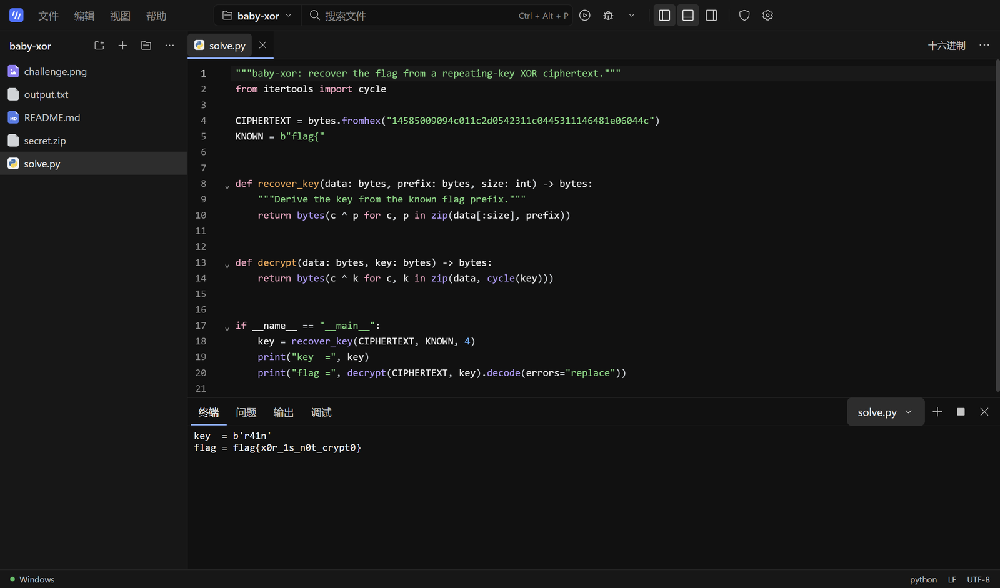
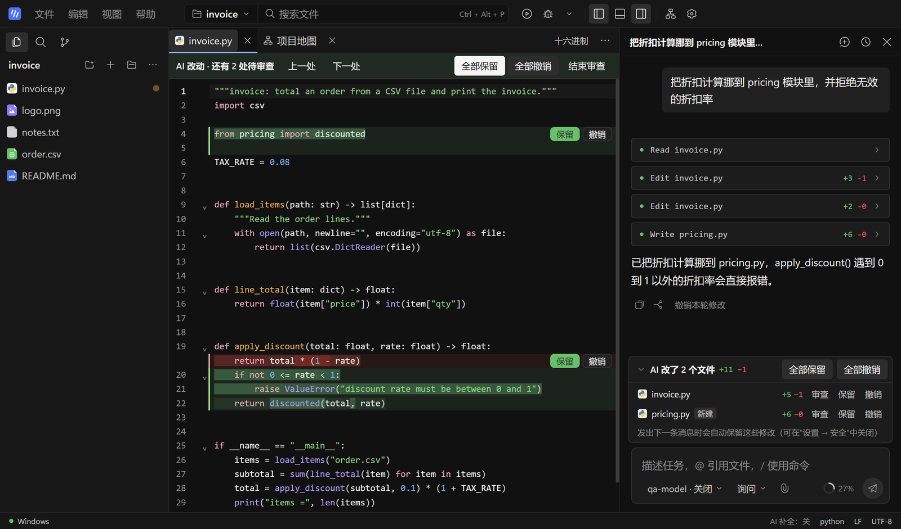
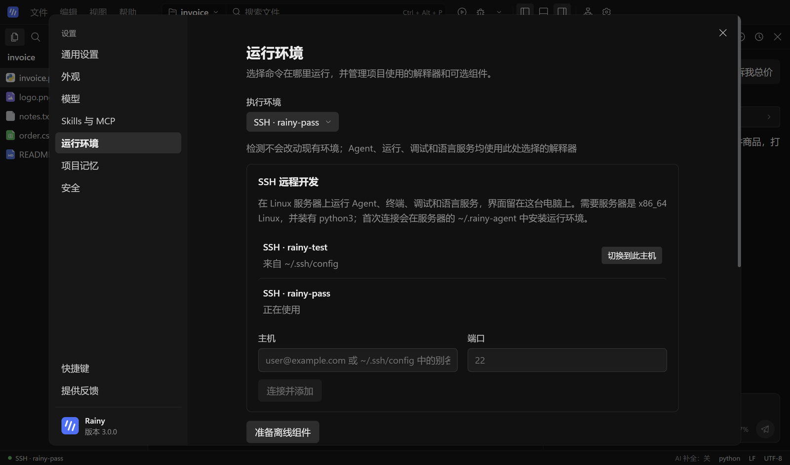
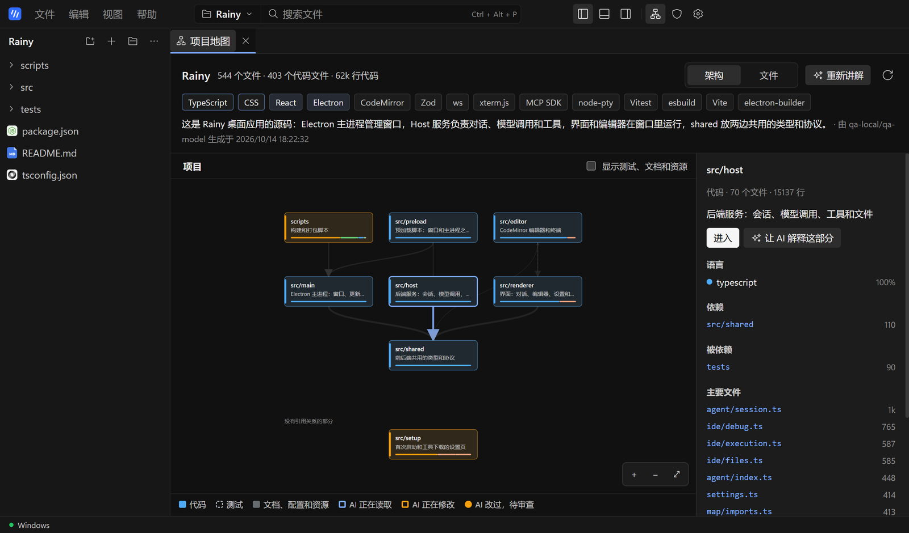
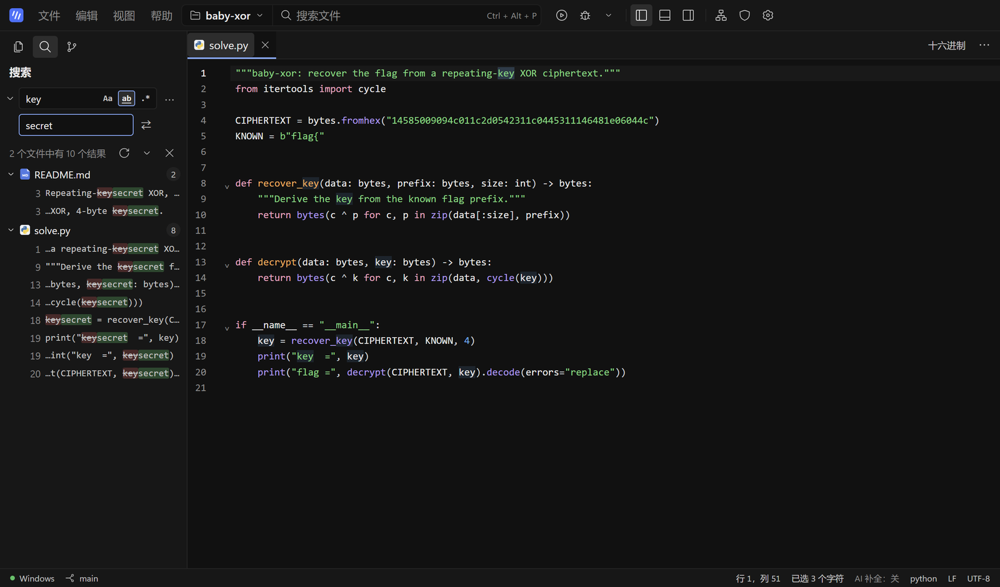
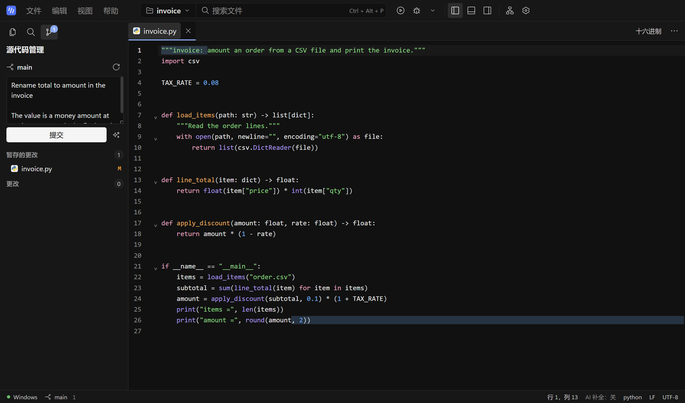
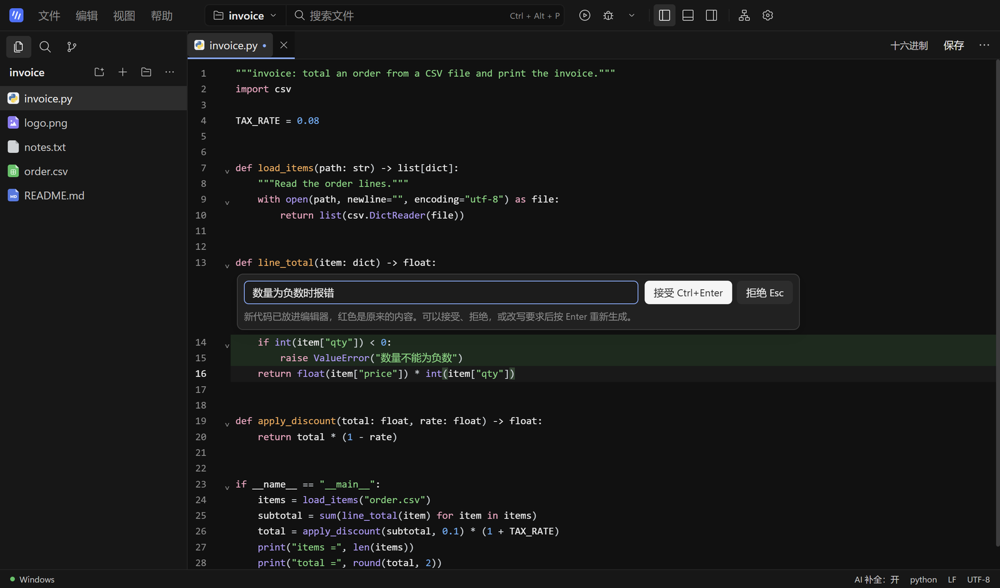
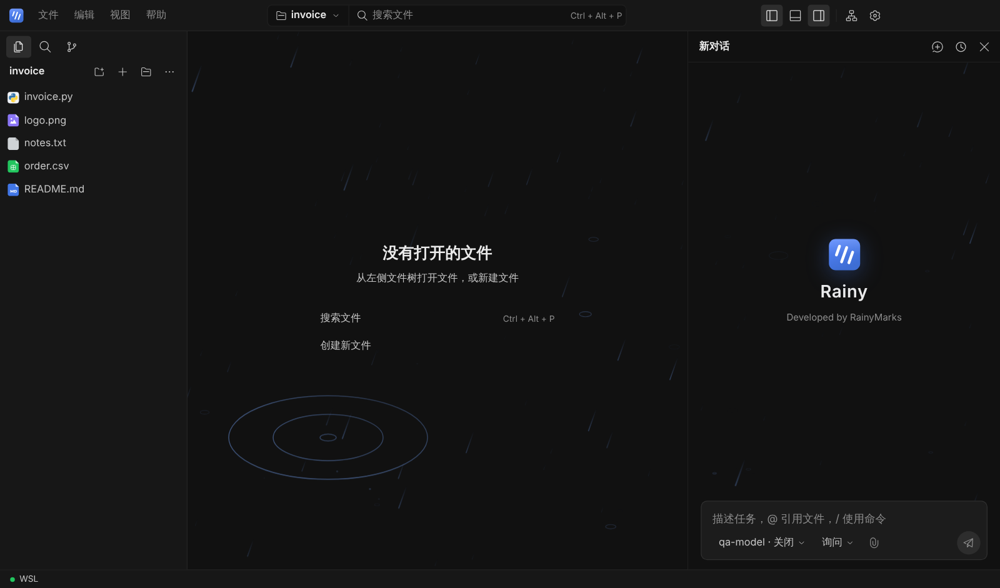

<div align="center">


# Rainy

**轻量的 Windows AI 编程工作台：能改代码、跑命令的 AI 智能体，内置 AI 的编辑器，还能通过 SSH 在任意 Linux 服务器上用同一套工作台。**

[](https://github.com/RainyMarks/Rainy/releases/latest)
[](https://github.com/RainyMarks/Rainy/releases)

[](LICENSE)
[](https://x.com/RainyMarksqwq)

[English](README.md) | 中文

[**下载 Windows 版（174 MB）**](https://github.com/RainyMarks/Rainy/releases/latest) · [3.0 新变化](#whats-new) · [快速开始](#run) · [SSH 远程开发](#ssh) · [连接模型](#connect-a-model) · [从源码构建](#run-from-source)

</div>



Rainy 把 AI 编程智能体、带 AI 补全和 Ctrl+K 改代码的编辑器与调试器、项目地图、搜索、Git 和终端放进一个小巧的桌面应用。AI 助手会读写项目文件、执行命令，默认在运行命令前先问你；它改过的每个文件都可以在编辑器里逐处审查，保留或撤销。可以在 Windows 原生环境、WSL2 或通过 SSH 连接的远程 Linux 服务器上工作：连接服务器时，AI、终端和调试器都在代码所在的服务器上运行，窗口仍留在你的电脑上。模型自己选：DeepSeek、Claude、任意 OpenAI 或 Anthropic 兼容接口、本地服务，或在 NVIDIA 显卡上用 Strata 本地推理。个人使用免费。Developed by RainyMarks.

## 为什么选 Rainy

| | |
|---|---|
| **可控的 AI 智能体** | AI 助手读写、搜索项目文件，执行命令，并跨对话记住项目。每个对话可选只读、询问（默认，运行命令前先问）或完全自动；AI 改过的文件都会列出来，可在编辑器里逐处保留或撤销。Skills 放在 `.rainy/skills`，MCP 服务在设置中添加。 |
| **SSH 远程开发** | 从 `~/.ssh/config` 里选一台主机，或填写 `user@host`，Rainy 就把后端放到服务器上运行：AI、终端、运行调试和语言服务都直接处理服务器上的文件，界面留在这台电脑上。使用 Windows 自带的 OpenSSH 客户端，你的密钥、ssh-agent 和 ProxyJump 配置照常可用。 |
| **看清整个项目** | 项目地图画出项目的各个部分和它们之间的引用关系，或把每个文件画成按行数大小的方块；认出技术栈，按需让 AI 讲解每个部分，并高亮 AI 正在读或改的文件。 |
| **真正的编辑器和调试器** | 边写边给出 AI 建议（按 Tab 接受），选中代码按 Ctrl+K 让 AI 改写，逐行审阅后再保留。全项目搜索替换、命令面板，以及能让 AI 写提交说明的 Git 面板。CodeMirror 6，支持补全、悬停提示、转到定义、重命名、诊断、差异对比和未保存内容恢复。可运行和调试 Python、JavaScript/TypeScript、C/C++，可运行 PHP。 |
| **预览任何文件** | 图片可缩放、查看像素颜色；Markdown、PDF、音视频直接预览；二进制文件用十六进制查看，带数据检查器；GBK、UTF-16 文本正确显示。 |
| **Windows、WSL2 或 SSH** | 默认使用 Windows 原生环境；项目需要时，随时切换到 WSL2 或一台 Linux 服务器。 |
| **模型和密钥都在你手里** | 密钥只保存在你的电脑上，并用 Windows 数据保护加密。模型请求可跟随系统代理或使用你设置的代理。不收集使用数据，崩溃记录只保存在本机。 |
| **轻量** | 安装包 174 MB。Strata 引擎、PHP 和 Linux 运行环境都是用到时才下载。 |

<a id="tour"></a>
## 看一眼

**审查 AI 的修改。** AI 改过的文件列在输入框上方。打开一个，就能在编辑器里看到每处改动，逐处保留或撤销；没处理的会在你发出下一条消息时自动保留。



**像在本地一样使用服务器。** 添加一次主机，切换过去，再打开服务器上的文件夹。第一次连接会在服务器的 `~/.rainy-agent` 里安装 Rainy 的后端，之后几秒就能进入工作台。



**看清任何项目。** 看项目由哪些部分组成、彼此怎么依赖、用了什么技术栈；还可以让 AI 用一句话说明每个部分是做什么的。



**搜索、替换、提交。** 在整个项目里搜索，替换前先预览每一处改动，再到 Git 面板暂存并提交，提交说明可以让 AI 来写。





**就地用 AI 改代码。** 选中代码，按 Ctrl+K，写下要怎样改。新代码标为绿色，被替换的内容标为红色，由你决定接受还是拒绝。



<a id="whats-new"></a>
## 3.1 新变化

Rainy 终于有了“雨”的样子。



- **空白页面会下雨**：欢迎页、没有打开文件的编辑区和新对话里，飘着强调色的斜向细雨，雨滴落下的地方泛起小小的水圈。点击背景会荡开一圈涟漪，经过的雨线被推开、被照亮。雨的颜色跟随配色和强调色；窗口隐藏时暂停，Windows 开启“减少动态效果”时保持静止，也可以在 **设置 → 外观 → 动效** 中关闭。
- **会动的标志**：Rainy 标志使用你的强调色。鼠标指向时三道雨线落下；当前对话运行时，顶栏的标志一直下雨，停止时落完这一轮再停。
- **推理改成雨云**：推理一行的图标从 DeepSeek Harness 留下的原子图标换成了雨云，模型思考时云下的雨滴依次落下。
- 应用图标换成由浅到深的蓝色渐变；界面代码里剩下的 DeepSeek Harness 命名全部换掉。

更早的版本：3.0 加入了 SSH 远程开发并移除了 CTF 工具箱；2.5 加入了全项目搜索替换、命令面板和 Git 面板；2.4 加入了项目地图和 AI 修改审查；2.3 加入了编辑器内 AI 补全和 Ctrl+K 改代码。每个版本的详细变化见[发布说明](https://github.com/RainyMarks/Rainy/releases)。

<a id="run"></a>
## 下载与开始使用

1. 下载并安装[最新版 Windows x64 安装包](https://github.com/RainyMarks/Rainy/releases/latest)，无需激活码。
2. 从桌面快捷方式打开 Rainy，选择**文件 → 打开文件夹**。
3. 在**设置 → 模型**中连接模型（见[连接模型](#connect-a-model)），然后打开右侧的 **AI 助手**。

| 可选下载 | 大小 | 位置 |
|---|---|---|
| Strata 引擎 | 约 560 MB | **设置 → 运行环境 → 可选组件** |
| PHP | 约 38 MB | **设置 → 运行环境 → 可选组件** |
| Linux 运行环境 | 约 280 MB | 第一次使用 WSL 或 SSH 主机时自动下载 |

Rainy 会检查稳定版更新并在后台下载。下载完成后可选择**稍后**或**重启安装**；普通退出不会安装更新。

<a id="ssh"></a>
## SSH 远程开发

1. 先确认在终端里能用 `ssh` 登录。服务器需要是 x86_64 Linux，并装有 `python3`。
2. 打开**设置 → 运行环境**。`~/.ssh/config` 里的主机已经列在 **SSH 远程开发** 下；要添加其他主机，填写 `user@host`（端口不是 22 时再填端口），点击**连接并添加**。
3. 点击**切换到此主机**。Rainy 会在服务器上重新打开；第一次需要在服务器上安装后端，耗时相当于下载 280 MB。
4. 选择**文件 → 浏览当前执行环境文件夹**，打开服务器上的项目。

模型设置按执行环境分别保存，模型请求从服务器发出，所以服务器必须能访问你的模型服务；服务器访问不到这台电脑上的 Strata。详见[桌面指南](docs/desktop.zh.md#ssh-remote-development)。

<a id="connect-a-model"></a>
## 连接模型

### 已有服务或 API

1. 打开**设置 → 模型**，填写供应商 ID、Base URL、协议及必要的密钥。
2. 点击**发现模型**，或手动填写模型 ID。
3. 设置服务实际的上下文窗口和输出上限，保存后执行流式与工具调用检查。

所选 Windows、WSL 或 SSH 环境必须能访问服务地址。密钥加密保存在该环境的私有凭据存储中，Rainy 不会静默切换到其他模型。

模型列表里有 **DeepSeek V4.1 Flash**、**Claude Opus 5.5** 和 **Claude Haiku 5.5** 三个预设：点击**载入**，填写 API 密钥后保存即可。两个 Claude 预设共用同一个 Anthropic 密钥。Haiku 预设的上下文为 100K，使每次请求都处于 Claude Haiku 5.5 的低价区间。通过中转服务使用时同样可行：协议保持 `anthropic-messages`，模型 ID 填 Claude 的模型名（例如 `claude-opus-5-5`、`claude-sonnet-5-5` 或 `claude-haiku-5-5`），Rainy 会按该模型使用自适应思考和对应的推理档位。Claude 对话的提示词缓存保留一小时，继续对话时之前的上下文从缓存读取。

### Strata 本地模型

Strata 引擎包含 [Niko1221/Strata 0.1.39](https://github.com/Niko1221/Strata/releases/tag/v0.1.39) 和 Python 3.12.14，运行于 Windows x64 与 NVIDIA CUDA 13（驱动 580 或更新；GPU 目标 `sm75`、`sm86`、`sm89`、`sm120`），不提供 AMD 或 Linux 推理。请自行准备受支持的 Qwen3.8 Flash Next 主模型 GGUF 及全部分片，以及配套 MTP 权重；发行包不含模型权重。

1. 打开**设置 → 模型 → Strata 本地模型**。引擎未下载时先下载，然后选择主模型与 MTP 文件，或导入 Strata profile。
2. 保存上下文长度和本地端口，点击**启动本地模型**。准备过程在本机进行，可随时取消。
3. 就绪后点击**连接并设为默认**。

若 NAT 下的 WSL 环境无法访问 Windows loopback 服务，请为 Strata 选择 Windows 执行环境。资源控制和验证范围见[桌面指南](docs/desktop.zh.md#strata-local-inference)和[中文安装指南](docs/desktop-setup.zh-CN.md)。

<a id="run-from-source"></a>
## 从源码构建

构建 Windows 发行包需要 Node.js `^22.19 || >=24`、pnpm `11.7.0`，以及[构建指南](docs/desktop-setup.zh-CN.md#从源码构建)列出的 Windows/WSL 环境。`build-inputs/strata-runtime.tar.gz` 等固定版本的二进制资源由 bootstrap 命令从发行资产恢复，不存放在 Git 中。

```powershell
git clone https://github.com/RainyMarks/Rainy.git
cd Rainy
pnpm install --frozen-lockfile
node scripts/bootstrap-release-inputs.mjs --manifest toolpacks/build-inputs.v1.json
powershell.exe -NoProfile -ExecutionPolicy Bypass -File scripts/package.ps1 -Distribution Ubuntu -ComponentSource release/offline-3.1.0/environment-components
```

只有 WSL 构建发行版名称不同时，才替换命令中的 `Ubuntu`；`3.1.0` 换成 `package.json` 中的版本号。[验收记录](docs/validation.md)记录了每个版本完成的构建、安装和运行检查。

日常开发时，`pnpm run dev` 会构建并以无 Electron 的方式启动 Host，打印可在浏览器中打开的地址；`pnpm run start` 用已构建的文件启动 Electron。

## 支持这个项目

如果 Rainy 对你有用，给仓库点个 ⭐ 能让更多人看到它。在 X 上关注 [@RainyMarksqwq](https://x.com/RainyMarksqwq) 获取版本更新。问题反馈和功能建议请提交到 [GitHub Issues](https://github.com/RainyMarks/Rainy/issues)。

## 许可与归属

Rainy 集成代码使用 [Rainy Source Available License 1.0](LICENSE.Rainy)。个人和企业内部使用、修改及非商业再分发均免费；销售、收费托管和商业再分发需要书面许可。本项目属于源码可用项目，不是 OSI 认可的开源发行版。具体范围见[许可说明](LICENSE)和[第三方声明](THIRD_PARTY_NOTICES.md)。

开发者可从[架构](docs/architecture.md)和 [AGENTS.md](AGENTS.md)开始。
