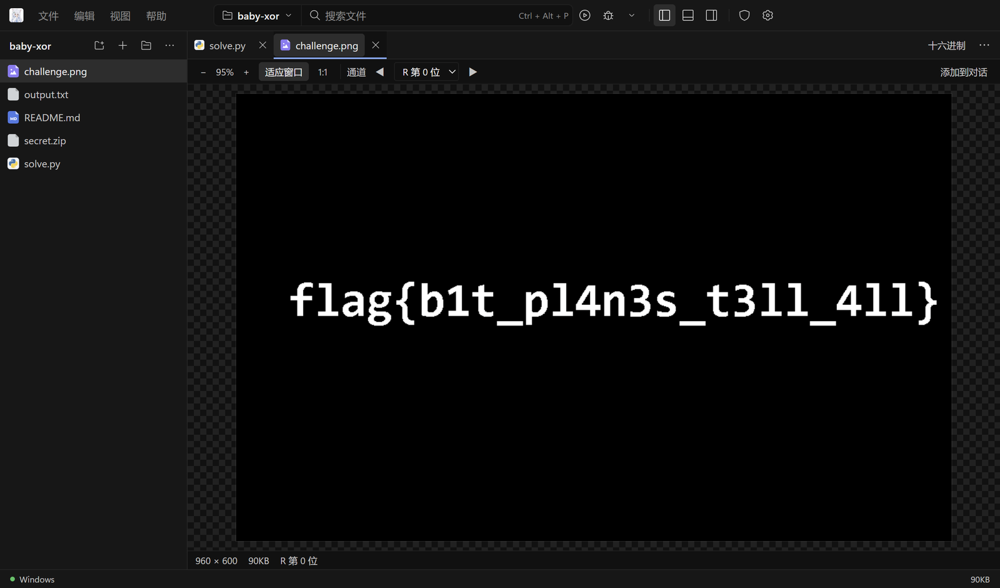
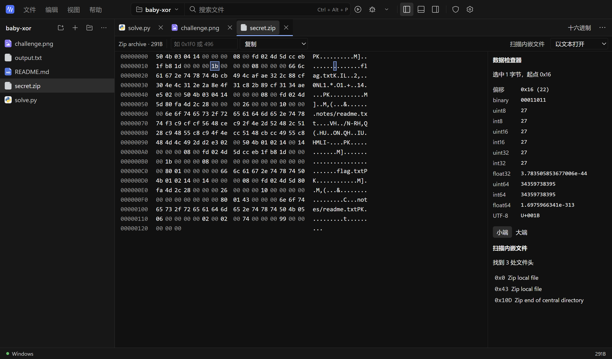
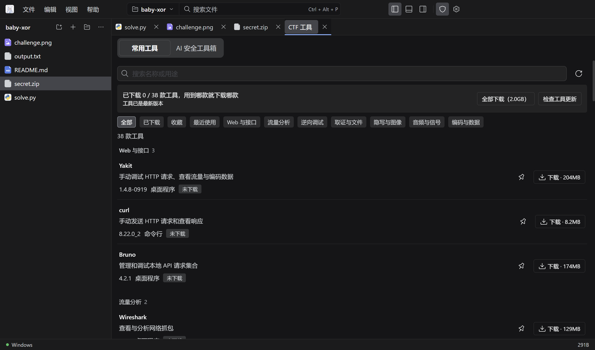

<div align="center">


# Rainy

**为 CTF 打造的 Windows AI 智能体工作台：写解题脚本、运行、让 AI 找出哪里不对，再打开 38 款安全工具中的任意一款，全程不离开这个窗口。**

[](https://github.com/RainyMarks/RainyAgent/releases/latest)
[](https://github.com/RainyMarks/RainyAgent/releases)

[](LICENSE)
[](https://x.com/RainyMarksqwq)

[English](README.md) | 中文

[**下载 Windows 版（189 MB）**](https://github.com/RainyMarks/RainyAgent/releases/latest) · [2.2 新变化](#whats-new) · [快速开始](#run) · [连接模型](#connect-a-model) · [从源码构建](#run-from-source)

</div>


Rainy 把 AI 编程智能体、真正的编辑器与调试器，以及 38 款 CTF 工具放进同一个桌面应用。AI 助手会读写项目文件、执行命令，默认在运行命令前先问你，改过的文件都能一键撤销。模型自己选：DeepSeek、Claude、任意 OpenAI 或 Anthropic 兼容接口、本地服务，或在 NVIDIA 显卡上用 Strata 本地推理。默认在 Windows 原生环境运行，题目需要 Linux 时可把项目切到 WSL2。个人使用免费。Developed by RainyMarks.

## 为什么选 Rainy

| | |
|---|---|
| **可控的 AI 智能体** | AI 助手读写、搜索项目文件，执行命令，并跨对话记住项目。每个对话可选只读、询问（默认，运行命令前先问）或完全自动；AI 改过的每个文件都能一键撤销。Skills 放在 `.rainy/skills`，MCP 服务（含 IDA 预设）在设置中添加。 |
| **38 款 CTF 工具，一键下载** | Wireshark、CyberChef、IDA、x64dbg、ImHex、JADX、dnSpy、StegSolve、Binwalk、Audacity、Sonic Visualiser 等，按 Web、流量、逆向、取证、隐写、音频、编码分类。每款单独下载、离线可用，有变化时才更新。 |
| **看清任何文件** | 图片支持缩放、查看像素颜色，一键切换颜色通道和位平面；二进制文件用十六进制查看，带数据检查器和类似 binwalk 的内嵌文件扫描；Markdown、PDF、音视频直接预览。 |
| **真正的编辑器和调试器** | CodeMirror 6，支持补全、悬停提示、转到定义、重命名、诊断、差异对比和未保存内容恢复。可运行和调试 Python、JavaScript/TypeScript、C/C++，可运行 PHP。 |
| **Windows 或 WSL2** | 默认使用 Windows 原生环境；题目需要 Linux 工具时，随时把项目切换到 WSL2。 |
| **模型和密钥都在你手里** | 密钥只保存在你的电脑上，并用 Windows 数据保护加密。模型请求可跟随系统代理或使用你设置的代理。不收集使用数据，崩溃记录只保存在本机。 |
| **轻量** | 安装包 189 MB。工具、Strata 引擎、PHP 和 WSL 运行环境都是用到时才下载。 |

<a id="tour"></a>
## 看一眼

**一键查看隐写。** 逐个切换颜色通道和位平面：这道题的 flag 藏在红色通道的最低位。



**带数据检查器的十六进制视图。** 任意字节都能按整数、浮点数或 UTF-8 解读，还能在整个文件里扫描内嵌的 PNG、ZIP、ELF 等文件头。



**用到哪款工具就下载哪款。** 按名称或用途搜索，只下载这道题需要的工具。



<a id="whats-new"></a>
## 2.2 新变化

- **RainyAgent 更名为 Rainy。** 应用和仓库不变：2.2 直接覆盖安装旧版本，设置、对话和工具都会保留。
- **外观设置**：
  - 七套配色：石墨、石板、午夜、暖沙、松林、玫瑰、纯黑。
  - 强调色可自选，用于链接、开关和焦点框，也可跟随配色。
  - 界面字体和代码字体可从电脑已安装的字体中选，也可手动输入。
  - 编辑器、终端和 AI 安全工具箱都会跟着变。
- **更沉稳的界面**：中性灰配色，标题加粗，按钮改为实心；设置窗口加大，每页有标题和说明，选项按卡片分组。

## 2.1 新变化

- **像 VS Code 一样预览文件**：
  - 图片可看颜色通道和位平面。
  - Markdown 有源码、预览、分栏三种视图。
  - PDF、音视频直接打开。
  - 任何文件都能用十六进制查看，带数据检查器和内嵌文件扫描。
  - GBK、UTF-16 文本正确显示。
- **AI 更可控**：
  - 三种权限模式：只读、询问、完全自动。运行命令、调用 MCP 工具、写项目外文件前会显示批准栏。
  - AI 改过的文件可一键撤销。
  - 新增文件名搜索和文件内容搜索工具。
- **网络与隐私**：
  - 模型请求可跟随系统代理（含 PAC）或使用你设置的代理。
  - API 密钥用 Windows 数据保护加密。
  - 崩溃记录只保存在本机，设置里可以导出抹去敏感信息的诊断压缩包。
- **安装包小了 35%**：189 MB（2.0 为 293 MB）。
- **2.1.1**：
  - 设置保存失败时，原因显示在按钮旁。
  - 已打开的对话保留各自的权限。
  - 修改模型后，已打开的对话立即生效。
  - 另有约 40 处修复，见[发布说明](https://github.com/RainyMarks/RainyAgent/releases/tag/v2.1.1)。
- **2.1.2**：界面圆角整体调小，浏览器工具台更名为 **AI 安全工具箱**。

从 1.x 升级：首次启动会导入 1.x 保存的模型、API 密钥和全局提示词。1.x 的对话格式较旧，不会导入。

<a id="run"></a>
## 下载与开始使用

1. 下载并安装[最新版 Windows x64 安装包](https://github.com/RainyMarks/RainyAgent/releases/latest)，无需激活码。
2. 从桌面快捷方式打开 Rainy，选择**文件 → 打开文件夹**。
3. 在**设置 → 模型**中连接模型（见[连接模型](#connect-a-model)），然后打开右侧的 **AI 助手**。
4. 进入 **CTF 工具 → 常用工具**，下载需要的工具，或点击**全部下载**。已下载的工具离线也能用。

| 可选下载 | 大小 | 位置 |
|---|---|---|
| Strata 引擎 | 约 560 MB | **设置 → 运行环境 → 可选组件** |
| PHP | 约 38 MB | **设置 → 运行环境 → 可选组件** |
| WSL 运行环境 | 约 296 MB | 首次以 WSL 启动时自动下载 |
| CTF 工具 | 每款 1 MB – 400 MB | **CTF 工具 → 常用工具** |

Rainy 会检查稳定版更新并在后台下载。下载完成后可选择**稍后**或**重启安装**；普通退出不会安装更新，更新也不会重新下载你的工具。详见[工具安装与更新](docs/desktop.zh.md#ctf-workbench)。

<a id="connect-a-model"></a>
## 连接模型

### 已有服务或 API

1. 打开**设置 → 模型**，填写供应商 ID、Base URL、协议及必要的密钥。
2. 点击**发现模型**，或手动填写模型 ID。
3. 设置服务实际的上下文窗口和输出上限，保存后执行流式与工具调用检查。

所选 Windows 或 WSL 环境必须能访问服务地址。密钥加密保存在该环境的私有凭据存储中，Rainy 不会静默切换到其他模型。

模型列表里有 **DeepSeek V4.1 Flash**、**Claude Opus 5.5** 和 **Claude Haiku 5.5** 三个预设：点击**载入**，填写 API 密钥后保存即可。两个 Claude 预设共用同一个 Anthropic 密钥。Haiku 预设的上下文为 100K，使每次请求都处于 Claude Haiku 5.5 的低价区间。通过中转服务使用时同样可行：协议保持 `anthropic-messages`，模型 ID 填 Claude 的模型名（例如 `claude-opus-5-5`、`claude-sonnet-5-5` 或 `claude-haiku-5-5`），Rainy 会按该模型使用自适应思考和对应的推理档位。Claude 对话的提示词缓存保留一小时，继续对话时之前的上下文从缓存读取。

### Strata 本地模型

Strata 引擎包含 [Niko1221/Strata 0.1.39](https://github.com/Niko1221/Strata/releases/tag/v0.1.39) 和 Python 3.12.14，运行于 Windows x64 与 NVIDIA CUDA 13（驱动 580 或更新；GPU 目标 `sm75`、`sm86`、`sm89`、`sm120`），不提供 AMD 或 Linux 推理。请自行准备受支持的 Qwen3.8 Flash Next 主模型 GGUF 及全部分片，以及配套 MTP 权重；发行包不含模型权重。

1. 打开**设置 → 模型 → Strata 本地模型**。引擎未下载时先下载，然后选择主模型与 MTP 文件，或导入 Strata profile。
2. 保存上下文长度和本地端口，点击**启动本地模型**。准备过程在本机进行，可随时取消。
3. 就绪后点击**连接并设为默认**。

若 NAT 下的 WSL 环境无法访问 Windows loopback 服务，请为 Strata 选择 Windows 执行环境。资源控制和验证范围见[桌面指南](docs/desktop.zh.md#strata-local-inference)和[中文安装指南](docs/desktop-setup.zh-CN.md)。

<a id="run-from-source"></a>
## 从源码构建

构建 Windows 发行包需要 Node.js `^22.19 || >=24`、pnpm `11.7.0`，以及[构建指南](docs/desktop-setup.zh-CN.md#从源码构建)列出的 Windows/WSL 环境。`build-inputs/strata-runtime.tar.gz` 等固定版本的二进制资源由 bootstrap 命令从发行资产恢复，不存放在 Git 中。

```powershell
git clone https://github.com/RainyMarks/RainyAgent.git
cd RainyAgent
pnpm install --frozen-lockfile
node scripts/bootstrap-release-inputs.mjs --manifest toolpacks/build-inputs.v1.json
powershell.exe -NoProfile -ExecutionPolicy Bypass -File scripts/package.ps1 -Distribution Ubuntu -ReuseNativeToolsRelease release/offline-2.1.3 -ComponentSource release/offline-2.1.3/environment-components
```

只有 WSL 构建发行版名称不同时，才替换命令中的 `Ubuntu`；`2.1.3` 换成 `package.json` 中的版本号。[验收记录](docs/validation.md)记录了每个版本完成的构建、安装和运行检查。

日常开发时，`pnpm run dev` 会构建并以无 Electron 的方式启动 Host，打印可在浏览器中打开的地址；`pnpm run start` 用已构建的文件启动 Electron。

## 支持这个项目

如果 Rainy 帮你解出了题，给仓库点个 ⭐ 能让更多选手看到它。在 X 上关注 [@RainyMarksqwq](https://x.com/RainyMarksqwq) 获取版本更新和 CTF 技巧。问题反馈和功能建议请提交到 [GitHub Issues](https://github.com/RainyMarks/RainyAgent/issues)。

## 许可与归属

Rainy 由独立团队维护。1.x 版本基于 [DeepSeek Harness 0.1.7-rc.2，提交 477b4f420553e8a52c2fbccc464d7561b239c443](https://github.com/deepseek-ai/deepseek-harness/tree/477b4f420553e8a52c2fbccc464d7561b239c443)。2.0 用 [pi-ai 与 pi-agent-core](https://www.npmjs.com/package/@earendil-works/pi-ai) 取代了该平台；源自它的界面基础组件和设计令牌继续使用 [MIT](LICENSE.upstream)。

Rainy 集成代码使用 [RainyAgent Source Available License 1.0](LICENSE.RainyAgent)。个人和企业内部使用、修改及非商业再分发均免费；销售、收费托管和商业再分发需要书面许可。本项目属于源码可用项目，不是 OSI 认可的开源发行版。具体范围见[许可说明](LICENSE)和[第三方声明](THIRD_PARTY_NOTICES.md)。

开发者可从[架构](docs/architecture.md)和 [AGENTS.md](AGENTS.md)开始。
